# Performance architecture plan

Status: **approved by the user on 2026-11-03** (decisions below). Docs only;
implementation proceeds phase by phase (section E), one PR per piece.

The project drifted:
- the first typed slice was stock EOD (about 270-byte messages, the least
  performance-sensitive endpoint);
- only 1 of 81 Python wrappers is typed;
- decode and memory were optimized on synthetic fixtures, while real latency
  is dominated by network round trips and vendor server time;
- the process (per-clause L1/L2/L3, 20 ADRs, matrices) was heavy for a
  one-endpoint client.

This plan redirects the work toward the workloads users actually run. It keeps
what is right: exact values, timestamp rigor, secret hygiene, CI (AGENTS.md
rule 3), decoder tests and live evidence.

**On hold, untouched by this plan:** item 8 / option 2a, the alpha.3 release,
and beta.1 work.

Notation: **[doc]** is current vendor documentation (fetched 2026-11-03, links
below). **[artifact]** is the pinned Python 1.0.17 package. **[observed]** is
our own authorized PROD runs. **[estimate]** is a project estimate to verify.
**[unknown]** is not established.

## Decisions (2026-11-03)

| # | Decision |
| --- | --- |
| 1 | **Python baseline exception approved**: a separate harness outside the workspace, a hash-pinned isolated venv, never in CI, run by the Coordinator on the user's machine with their key (C.1; AGENTS.md) |
| 2 | **Targets approved** as proposed (B) |
| 3 | **Dependencies `arrow-rs`, `parquet` and `pyo3` approved as a set for P1**; Arrow Flight later |
| 4 | **Real-time uses the official Terminal path only**, within ThetaData's terms. No undocumented direct FPSS. Plus a review of ThetaDataDx (section H) |
| 5 | **Python is a thin pass-through over Rust-built columns** (aero1553 pattern; D.3). Vendor-compatible names are zero-cost aliases; enhanced functions are the primary API. A benchmark proves the compatibility path adds no overhead and no per-row Python objects |
| 6 | **Lighter process approved**; ADR-0007 and the slice-by-slice roadmap are superseded (F) |
| 7 | The user asks ThetaData the open vendor questions (G.8) directly |

---

## A. Vendor facts

### A.1 Tiers, concurrency and request limits

| Fact | Value | Source / confidence |
| --- | --- | --- |
| Concurrent requests per account | FREE **1**, VALUE **2**, STANDARD **4**, PRO **8** | [doc: Concurrent Requests][conc]. A second vendor page lists 1/1/2/4 "server threads" for the older HTTP API ([doc][conc-v2]); treat 1/2/4/8 as current, **verify per tier** |
| Scope | Account-wide, set by the **highest** tier held across asset classes; more subscriptions do not add slots | [doc][conc] |
| Over the limit | Requests queue (default queue 16, configurable to 128); beyond the queue, HTTP **429** | [doc][conc]. Written for the Terminal REST API; **[unknown]** whether direct gRPC queues, rejects (and with which gRPC code) or throttles |
| Rate limit (FREE) | "20 requests/minute" in prose, **30 reqs/min** in the tier tables | [doc: Subscriptions][subs]: contradictory, **measure on FREE** |
| Rate limit (paid) | "NOT rate-limited in any way", concurrency only | [doc][conc] |
| Python library parallelism | Synchronous wrappers, one gRPC channel, no scheduler, retry, rate limiter or concurrency | [artifact], [research](../research/thetadata-1.0.12.md#transport-and-errors) |

### A.2 History depth, products and endpoints per tier

| Product | FREE | VALUE | STANDARD | PRO | Source |
| --- | --- | --- | --- | --- | --- |
| Stocks: granularity, start, delay | EOD only, from 2023-06-01, 1-day delay | 1-minute, from 2021-01-01, 15-minute delay | 1-minute, from 2016-01-01, real-time | **tick**, from 2012-06-01, real-time | [doc][subs] |
| Options: granularity, start, delay | EOD only, from 2023-06-01, 1-day delay | 1-minute, from 2020-01-01, real-time | **tick**, from 2016-01-01, real-time | tick, from 2012-06-01, real-time | [doc][subs] |
| Indices | none | 1-minute, from 2023-01-01, 15-minute delay | from 2022-01-01, real-time | from 2017-01-01, real-time; NDX/Nasdaq GIDs need PRO | [doc][subs] |
| Interest rates | EOD from 2024-01-01 | EOD from 1970-01-01 | — | — | [doc][subs] (its endpoint table contradicts VALUE) |
| Options price per month | — | **$40** | **$80** | **$160** | [doc: pricing][pricing] |
| Stocks/indices price per month | — | [unknown] | [unknown] | [unknown] | pricing page shows options only; **ask the user / vendor** |
| Option Greeks history | — | IV and 1st order (inferred from table) | + trade Greeks, 2nd/3rd order (inferred) | all | [doc][subs]: table alignment is broken, **verify** |
| Option tick quotes/trades, trade_quote | — | — | yes | yes | [doc][subs], [pricing] ("every NBBO quote reported by OPRA") |
| Flat files | — | — | — | **PRO only** (beta); only the last 7 calendar days | [doc: flat files][flat] |
| Futures | 17 RPCs in the descriptor | no wrapper, no docs | | | [artifact] 1.0.16; entitlement [unknown] |

**P0 measurements (2026-11-03, [results](../performance/p0-results.md)), observed and not guaranteed:**
- FREE served **≥ 3 concurrent requests in parallel** (not probed higher);
- **no per-minute limit at up to 40/min**;
- **an EOD request may span at most 366-730 days** (731 days gives
  `INVALID_ARGUMENT`);
- **one row per gRPC message**, each an independent ZSTD frame. This holds
  for EOD only: option tick and interval history carries hundreds to
  thousands of rows per message (`opt-sizes-001`,
  [options phase](options-phase.md#workload-sizes-opt-sizes-001-2026-11-05)).

**Our FREE observations** ([live observations](../research/live-observations.md)):
- stock EOD works for 2024-01 and 2024-06, and 2020-08 is denied, consistent
  with the documented 2023-06-01 start;
- the AAPL **stock snapshot quote is denied** (`PERMISSION_DENIED`, message
  says VALUE is required), although the docs table suggests a 15-minute
  delayed quote snapshot on FREE. Docs and service disagree, so we trust the
  service;
- EOD history is not split-adjusted, and price scale varies per value;
- concurrency and per-minute limits are **not yet measured**.

### A.3 Pagination and response sizes for heavy endpoints

| Fact | Value | Source |
| --- | --- | --- |
| Recommended request span | stock tick: 1 day; option tick: 1 week, or **1 day** for liquid roots (AAPL, SPX, SPY); option 100 ms: 1 week; option 1 s: 1 month; EOD: 1 month | [doc: Request Sizing][sizing] |
| Recommended response size | "under 1 million ticks"; larger requests risk client or server out-of-memory | [doc][sizing] |
| Pagination | Terminal HTTP: a `next_page` header URL until it reads "null" | [doc (v2 HTTP)][page]. Direct gRPC has **no pagination**: one finite server stream of `ResponseData` batches ([artifact]). Batch size per message [unknown]; EOD batches were about 270 B per row-batch [observed] |
| Option trade_quote flat file | about **1.2 GB/day**, about 3 minutes to serve; stock trade_quote about 14 GB/day | [doc][flat] |
| Max message we accept today | 64 MiB encoded per gRPC message (our limit) | this repo |

So the client, not the vendor, must split large jobs (for example per
contract or expiration and per day) and keep each request under about 1M rows.
Throughput then comes from running these requests concurrently, up to the
tier's limit.

### A.4 Real-time delivery

| Path | Facts | Source |
| --- | --- | --- |
| Terminal WebSocket | The Java Terminal connects to **FPSS** and re-serves JSON events on `ws://127.0.0.1:25520/v1/events`. **One connection only**; the client must fan out. A STATUS heartbeat every 1 s. Option strikes are in 1/10 cent. | [doc: Streaming][stream] |
| Stream types | stocks/options: full trade, trade, quote, market value; indices: price, market value | [doc][stream] |
| Stream entitlement | FREE and VALUE: **0 contracts**. STANDARD: options 10k quote / 15k trade contracts, stocks 1k/1k. PRO: options 15k quote / unlimited trades plus the full trade stream; stocks 2k quote / 20k trades | [doc][subs] |
| Direct FPSS (no Terminal) | **[unknown] / undocumented.** ThetaDataDx claims direct streaming with one live session per account (a second session evicts the first) ([README][dx]); not verified by us | third party |
| Ordering, sequence numbers, gap signalling | [unknown]: not documented | — |

**Implication:** real-time work needs **at least STANDARD**. Via the Terminal,
our added latency sits on top of a Java relay plus JSON serialization. Our
part can be tiny (parse, hand-off), but end-to-end latency is the vendor's.

### A.5 Sources

[conc]: https://thetadata.net/docs/Articles/Data-And-Requests/Concurrent-Requests.html
[conc-v2]: https://http-docs.thetadata.us/Articles/Performance-And-Tuning/Concurrent-Requests.html
[subs]: https://thetadata.net/docs/Articles/Getting-Started/Subscriptions.html
[pricing]: https://www.thetadata.net/pricing
[sizing]: https://thetadata.net/docs/Articles/Data-And-Requests/Request-Sizing.html
[page]: https://http-docs.thetadata.us/Articles/Performance-And-Tuning/Pagination.html
[flat]: https://thetadata.net/blog/2025-05-21-flat-files-beta
[stream]: https://thetadata.net/docs/Streaming/Getting-Started.html
[dx]: https://github.com/userFRM/ThetaDataDx

All vendor pages: [Concurrent Requests][conc], [Concurrent Requests (v2 HTTP)][conc-v2],
[Subscriptions][subs], [pricing][pricing], [Request Sizing][sizing],
[Pagination (v2 HTTP)][page], [flat files beta][flat], [Streaming][stream].
Third party: [ThetaDataDx README][dx]. The pinned artifact research:
[1.0.12](../research/thetadata-1.0.12.md) and
[1.0.13-1.0.17](../research/thetadata-1.0.13-1.0.17.md).
Re-verify all of them at each tier upgrade; vendor pages contradict each other.
Re-verified for options PRO on 2026-11-05: [options phase plan](options-phase.md#a-vendor-facts-re-verified-for-pro-2026-11-05).

---

## B. Workload catalogue and measurable targets

Volumes marked [estimate] are orders of magnitude to replace with the first
measured capture. "Python" means the vendor package 1.0.17 as shipped
(synchronous). Where a fair comparison needs it, a threaded Python variant
uses the same concurrency.

| ID | Workload | Endpoint(s) | Realistic volume [estimate] | Metrics that matter | Minimum tier |
| --- | --- | --- | --- | --- | --- |
| W1 | Bulk EOD backfill, stocks and options | `stock_history_eod`, `option_history_eod`, `*_list_*` discovery | 500 symbols × 2.5 years ≈ 300k rows; an option chain EOD ≈ 1-10k contracts × days; one request per symbol-month | **time to complete** (bounded by limits), rows/s, peak memory, CPU per row | **FREE** (from 2023-06-01; 1 concurrent; 20-30/min) |
| W2 | Option chain EOD/OI snapshot of one day | `option_history_eod`, `option_history_open_interest`, `option_list_contracts` | SPY: about 5-10k contracts/day, a few MB | time to complete, time to first row | FREE (EOD); OI also on FREE per [subs] [verify] |
| W3 | Intraday 1-minute OHLC for many symbols | `stock_history_ohlc`, `index_history_ohlc`, `option_history_ohlc` | 500 stocks × 390 bars/day ≈ 195k rows/day | rows/s, time to complete, memory | **VALUE** |
| W4 | Option quotes at 1-minute or 1 s resolution for a chain | `option_history_quote` (interval), `option_history_greeks_*` (interval) | SPY chain day at 1-min: about 10k contracts × 390 ≈ 4M rows | rows/s, MB/s, peak memory, Parquet write rate | **VALUE** (1-min); 1 s/100 ms needs STANDARD [verify] |
| W5 | Tick-level option quote/trade history, one day | `option_history_quote`, `_trade`, `_trade_quote` (tick) | liquid root day: **10M-100M+ rows**, GBs; split per expiration/contract to stay under 1M rows/request | **throughput (rows/s, MB/s)**, time to complete, peak memory, CPU | **STANDARD** |
| W6 | Greeks history (interval and trade-based) | `option_history_greeks_*`, `*_implied_volatility` | like W4/W5 with more columns | rows/s, exact decimals | VALUE (IV, 1st order) / STANDARD (higher order, trade Greeks) [verify] |
| W7 | Stock tick trades/quotes, many symbols | `stock_history_trade`, `_quote`, `_trade_quote` | 1 day of SPY quotes ≈ 10M+ rows | rows/s, memory | **PRO** (stock tick) |
| W8 | Snapshots (poll) | `*_snapshot_*` (quote, OHLC, trade, Greeks) | one row per contract; polled | **time to first row / latency**, p50/p99 per poll | stock snapshots: VALUE (observed denial on FREE) |
| W9 | Flat files | `*_flat_file_*` | option trade_quote about 1.2 GB/day | MB/s to Parquet, peak memory (must be bounded) | **PRO** |
| W10 | Real-time quotes/trades for N contracts | Terminal WebSocket (FPSS) | N = 100 to 15k contracts; bursts at the open | **added latency** (receive to user callback, p50/p99/p99.9), no drops, gap detection, CPU | **STANDARD** |

**Targets** (proposed for approval; all are relative to the measured Python
baseline on the same host and account):

- **Network-bound workloads** (W1-W7 time to complete): at least as fast as
  Python with the same concurrency, and **≥ C× faster than the synchronous
  package**, where C is the tier's concurrency (1/2/4/8) minus scheduling
  losses.
  - Honest ceiling: when the vendor serves a request in seconds, nobody beats
    the network; the win is saturation plus zero client-side stalls.
- **CPU-bound part** (decode plus DataFrame build, measured offline on
  captured responses): **≥ 10× fewer CPU-seconds per million rows** than
  Python with Polars, and ≥ 20× than Pandas [target to confirm after the
  first baseline].
- **Peak memory:** bounded by configuration and ≤ 0.5× Python for the same
  result (Python accumulates every row as Python objects before building the
  frame).
- **Time to first row:** first Arrow batch ≤ 1.2× the vendor's first-message
  arrival (Python returns nothing until the whole result is built).
- **W10 added latency:** our receive-to-callback p99 ≤ 50 µs, with no
  allocation on the hot path, measured separately from the Terminal's own
  delay.

---

## C. Baseline method

### C.1 Vendor Python baseline: the approved scoped exception

AGENTS.md says: never import or execute the vendor package. **The exception
approved on 2026-11-03** (now in AGENTS.md):

> The vendor package may be executed **only** by the Python baseline harness
> in `bench/python-baseline/`. That directory sits outside the Cargo
> workspace and is excluded from packaging, CI, tests and every tool in
> `tools/`. It is run **manually by the Coordinator on the user's machine**
> with the user's own key, taken from an environment variable and never
> written to disk or logs.
> - It installs `thetadata==1.0.17` into a fresh, isolated virtual
>   environment from a hash-pinned requirements file (`--require-hashes`;
>   wheel SHA-256
>   `a43a2fe0fc4896047b9287a9cbf725214386566e3adf930523e5f8aeabf81fea`),
>   with pinned Polars, pandas and dependencies.
> - Its outputs are timing JSON only, plus private captures under ignored
>   `artifacts/`. No vendor code or rows are committed.
> - No other code may import the package, and the exception covers only
>   1.0.17 or a later version approved by the same process.

Harness design (in the PR that implements phase 0, not now):

- **Workloads:** W1-W10 parameter files, shared with the Rust harness, so both
  sides run identical requests on the same host, account, time window and
  network.
- **Three measurements per workload:**
  1. **End to end:** the public wrapper call returning a Polars DataFrame,
     and again with `dataframe_type='pandas'`.
  2. **Network plus server:** the package's own generated stub method, with
     the response stream drained without conversion. This gives time to
     first message, time to last message and bytes.
  3. **Conversion only:** the captured `ResponseData` sequence (from 2)
     replayed offline through the package's converter, for Polars and pandas.
     This is pure CPU, separable from the network.
- **Threaded variant:** the same requests from a `ThreadPoolExecutor` sized to
  the tier's concurrency, so a "Rust beats Python" claim isn't merely "Rust
  uses concurrency".
- **Repetition:** interleaved Python/Rust rounds (ABBA), ≥ 5 per workload,
  during the same market session, so vendor load and network variance are
  shared. Report medians and spreads, with the D-B min/max-over-rounds rule.

### C.2 Instrumented breakdown for the Rust client

Before any optimization, record per query (an opt-in `metrics` feature, plain
`Instant` timestamps, no new dependency):

- dispatch → response headers (vendor queueing plus server start);
- per message: time waiting in the transport (network/server), bytes, and the
  time from the first byte to the complete frame;
- decode time (decompress, parse, columnar build) and hand-off time;
- consumer time (between `next_batch` calls), which is never billed as ours;
- scheduler: queue wait per request, achieved concurrency against the limit,
  retries and backoff time.

Plus the same **offline replay** of captured responses (the existing
`live_eod replay` pattern) for CPU-only figures. Every result says what
dominated: network/server, our CPU or the consumer.

---

## D. Target architecture

```mermaid
flowchart LR
  subgraph Clients
    R["Rust API"]
    P["PyO3 thin pass-through<br/>Arrow C Stream, vendor-name aliases"]
    S["Local service: Arrow Flight or gRPC"]
  end
  Clients --> Q["Request planner and scheduler<br/>split, tier-aware concurrency,<br/>retry/backoff, cancellation"]
  Q --> G["Generated typed requests<br/>all 100 RPCs from descriptor + 1.0.17 catalogue"]
  G --> T["Direct gRPC transport<br/>framing guard, bounded admission"]
  T --> D["Columnar decoder<br/>ZSTD stream, protobuf rows, Arrow builders"]
  D --> A["Arrow RecordBatch<br/>Decimal128 38,10 and Timestamp ns + tz"]
  A --> K["Sinks: Parquet, Arrow IPC, callbacks"]
  RT["Real-time adapter<br/>Terminal WebSocket now, direct FPSS only if verified"] --> RB["Bounded SPSC queues<br/>no hot-path allocation, gap detection"]
  RB --> Clients
```

| Component | Design | HFT-informed detail | Honest limit |
| --- | --- | --- | --- |
| **Planner and scheduler** | Splits jobs (per contract or expiration, per day, ≤ about 1M rows), runs them through a semaphore sized to the tier (1/2/4/8, configurable, discovered by probing), plus a per-minute limiter on FREE | Keeps every slot busy (pipelines the next request before the current stream ends); retries with jittered exponential backoff on `RESOURCE_EXHAUSTED`/`UNAVAILABLE` only; cancellation propagates; deterministic, resumable job manifests | Wall time ≥ total vendor time ÷ concurrency |
| **Generated typed requests** | A build step generates typed request builders, enums and validation for **every** RPC, from the descriptor plus the 1.0.17 catalogue (defaults, presence rules, doc text). Hand-written code only for cross-cutting rules (dates, contract specs) | Zero cost at run time; one code path | Server semantics stay unverified per endpoint until live evidence |
| **Columnar decoder** | Decodes `DataTable` rows straight into Arrow builders: exact `Decimal128(38,10)` for `Price` (every wire scale 0..19 maps exactly; no per-batch scale negotiation), `Timestamp(ns)` with time-zone metadata (honoring `nanos`/`precision` once their meaning is verified; out-of-range values rejected), dictionary-encoded strings | Builders pre-sized from the existing preflight counts, one pass, no per-cell allocation, ZSTD streaming, buffer reuse across batches | Decode is a small share when the network dominates; it matters for CPU per row, memory and Python |
| **Zero-copy hand-off** | Arrow buffers move to the consumer; IPC/C Data Interface to Python (Polars, PyArrow, pandas via Arrow) | No copies after decode | — |
| **Sinks** | Parquet writer (row groups per batch), Arrow IPC, callbacks | Streamed: memory ≈ one in-flight batch per worker | — |
| **PyO3 bindings** | A thin pass-through: Rust does all the work and returns Arrow data through the C Stream interface; see D.3 | No per-row Python objects; GIL released for I/O and decode | Building a pandas object frame (if the user asks for one) is the consumer's cost |
| **Real-time** | `RealtimeSource` trait over the **official Terminal WebSocket only** (decision 4). No undocumented direct FPSS | One reader thread, bounded SPSC ring per consumer, preallocated messages, a parse straight into fixed structs (no `serde_json::Value`), drop/backpressure policy explicit, heartbeat and gap detection, metrics | End-to-end latency includes the vendor's Java relay; we can only minimize our part |
| **Local service (optional)** | Arrow Flight (or gRPC) server: one authenticated process, shared scheduler and cache, many consumers **of the same licensee** | Respects the account-wide concurrency for all consumers | A new dependency set; opt-in binary. It **binds to localhost by default and never serves other people**: the terms limit data to the licensee's internal personal use and forbid redistribution and credential sharing (H.2) |

### D.1 Keep and rework

| Today | Decision |
| --- | --- |
| `praevis-thetadata-auth` (in-memory sessions, native-store opt-in, redaction) | **Keep** as is |
| `praevis-thetadata-core` exact `Price`, `Timestamp`, timezone rules, `MAX_EPOCH_MS` | **Keep** the semantics; add Arrow conversions (Decimal128/Timestamp ns, with the year-2262 bound documented) |
| `praevis-thetadata-proto` (descriptor, 100 RPCs, manifest) | **Keep**; becomes the generator input |
| Generated raw helpers | **Keep**, as the base of the typed generator |
| Typed stock EOD (`StockEodRequest`, `EodBatchStream`, Table adapter) | **Rework**: becomes one generated endpoint over the common columnar path. The current API stays until the generated one is accepted |
| Bounded decoder (`bounded.rs`) preflight, limits, hand reader, corpus | **Keep** the limits, preflight and fuzz corpus; replace the output stage (`DataBatch` → Arrow builders) |
| Admission (jobs, streams, shared budget), deadlines, cancellation, paused-clock tests | **Keep**; the scheduler sits above it |
| `framing.rs` guard | **Keep**; it is the entry point where option 2a would live |
| Benchmarks, memory profile, live capture/replay tooling | **Keep**; extend to W1-W10 |
| CLI | **Keep** auth; add `fetch`/`export` commands later, built on the planner |

### D.2 Python interface: a thin pass-through (decision 5)

The pattern follows [aero1553](https://github.com/joey-huckabee/aero1553)
(`python/native/src/table.rs`, `python/src/aero1553/table.py`): Rust builds one
typed buffer per column with the GIL released, and Python never creates an
object per row. Our version goes one step further and avoids even the single
copy into Python `bytes`, by sharing Arrow memory.

**Layers**

1. **Native (Rust, `pyo3`):** every query runs in Rust (scheduler, transport,
   decode into Arrow builders) inside `py.detach(...)`. The GIL is released
   for the whole I/O and decode.
2. **Hand-off:** results are Arrow record batches exported through the
   **Arrow C Stream interface**, using the `__arrow_c_stream__` PyCapsule
   protocol. pyarrow (`pa.table(obj)` / `pa.RecordBatchReader.from_stream`),
   Polars (`pl.from_arrow`) and pandas (via pyarrow, or the PyCapsule
   interface in pandas ≥ 2.2) import the buffers **without copying**. NumPy
   views come from the Arrow buffers of numeric columns. Exact prices stay
   `Decimal128(38,10)`; timestamps are `timestamp[ns, tz]`.
3. **Python package:** pure pass-through wrappers (argument checking, keyword
   forwarding, docs), with no data handling.

**API**

- **Primary (enhanced) API:**
  - `client.history(...)` / `client.<endpoint>(...)` returns an Arrow-backed
    result object with `__arrow_c_stream__`, `.to_polars()`, `.to_pandas()`
    and `.to_arrow()` (each conversion zero-copy where the target allows);
  - `client.<endpoint>_batches(...)` returns a **streaming batch iterator** for
    large jobs, with bounded memory;
  - `client.<endpoint>_to_parquet(path, ...)` writes Parquet from Rust;
  - arguments for concurrency, sharding, deadlines and cancellation.
- **Compatibility layer:** every vendor name (`stock_history_eod`,
  `option_history_quote`, …) is a **thin alias** that forwards to the same
  native call:
  - vendor signatures and defaults, generated from the 1.0.17 catalogue;
  - `dataframe_type='polars'|'pandas'` maps to the same zero-copy conversion;
  - vendor names may gain the enhanced optional keyword arguments;
  - **no extra work on the hot path.** Vendor behaviors that would cost
    performance (synchronous whole-result materialization) are available only
    as what they are: the same native call plus a final conversion.

**Benchmark gates** (part of P1 exit):

- **Compatibility overhead:** the vendor-named alias against the native call,
  on identical replayed responses (W1/W2 captures plus large synthetic
  tables). The difference must be within the measurement noise (D-B
  rule-style min/max over ≥ 3 rounds), and no more than a fixed per-call
  constant (target ≤ 5 µs per call, independent of row count).
- **No per-row Python objects:** count Python allocations, using
  `tracemalloc` and `sys.getallocatedblocks()` deltas, while producing 1M
  rows, as Arrow and as Polars. Target: allocations per million rows ≈ 0,
  meaning a constant independent of the row count, verified at 1M and 10M
  rows.

### D.3 Option 2a in this design

Not moot. In the target design, our framing layer assembles each gRPC message
(option 2a) and hands it to the columnar decoder; tonic's decode buffer
(item 8) disappears in the process. A fully streaming decoder (option 2b:
protobuf rows straight into Arrow builders as bytes arrive) is the natural
next step and becomes cheap once rows are decoded into builders anyway. So 2a
should be **re-evaluated inside the columnar work**, not merged separately
now (it stays on hold, as instructed).

---

## E. Phased roadmap tied to tiers

| Phase | Tier needed | Build | Measure (workloads) | Exit criteria |
| --- | --- | --- | --- | --- |
| **P0: measure first** ([done 2026-11-03](../performance/p0-results.md)) | **FREE** | Python baseline harness (C.1); Rust breakdown instrumentation (C.2); bounded probes of FREE concurrency, per-minute limit, over-limit behavior and batch sizes (stop at the first 429-like or `RESOURCE_EXHAUSTED`); ThetaDataDx review (H) | W1, W2 | Breakdown published for both clients: share of network, server, decode and frame build; FREE limits measured; review recorded |
| **P1: breadth and columnar on FREE** ([design, approved 2026-11-04](p1-design.md)) | **FREE** | Generated typed requests for all RPCs; columnar Arrow decoder; Parquet sink; PyO3 pass-through (D.2) for FREE-entitled endpoints; scheduler with tier profiles | W1, W2 (plus synthetic large fixtures for W4/W5 shapes) | (a) every FREE-entitled endpoint returns correct exact data on live checks; (b) W1 time to complete ≤ Python's (both capped by the limit); (c) CPU per million rows ≥ 10× better than Python with Polars on replayed captures; (d) peak memory ≤ 0.5× Python; (e) compatibility alias overhead within noise and no per-row Python objects (D.2 gates) |
| ⬆ **Upgrade 1: options VALUE ($40/month)** | VALUE | Scheduler at 2 concurrent; 1-minute intraday | W3, W4 (1-min), W6 (IV, 1st order) | W3/W4 time to complete ≥ 1.8× the synchronous Python package and ≥ 1.0× threaded Python; CPU and memory targets hold at volume |
| ⬆ **Upgrade 2: options STANDARD ($80/month)** | STANDARD | Tick-level option history at volume; real-time Terminal adapter; local service mode (optional) | W5, W6 (all), W10 | W5 ≥ 3.5× synchronous Python and ≥ 1.0× threaded; peak memory bounded by configuration under W5; W10 added p99 ≤ 50 µs, no drops below the documented contract limits |
| ⬆ **Upgrade 3: PRO ($160/month options; stock PRO price [unknown])** | PRO | 8-way scheduler; flat files to Parquet; full trade stream; stock tick (W7) | W5 at 8×, W7, W9, W10 full stream | W5 ≥ 7× synchronous Python; W9 ingest bounded by network/disk with bounded memory; W10 sustained full-stream load without drops |

**When the user must upgrade, and why:**
1. **After P1 exits**, everything measurable on FREE is done: EOD-only data
   with 1 concurrent slot can't exercise intraday volume or concurrency.
   **Options VALUE ($40)** unlocks 1-minute history and 2 concurrent slots.
2. **For tick-level history (W5, the main performance case) and any real-time
   work (W10): options STANDARD ($80).** FREE and VALUE have 0 streaming
   contracts.
3. **For flat files, the full trade stream, 8-way concurrency and stock tick
   data: PRO.** Stock tier prices are not on the pricing page; confirm with
   the vendor before upgrading stocks. Concurrency is account-wide, so one PRO
   subscription raises the slots for every product.

---

## F. Process simplification

| Keep | Lighten or drop |
| --- | --- |
| CI rule 3: every workflow green, never merge over red or pending | Per-clause L1/L2/L3 matrices for **generated** endpoints. Instead: one generated coverage table (endpoint → typed builder → decoder test → live evidence status), produced by a tool |
| Exactness: decimal prices, timestamp rules, no silent precision loss | New ADRs for routine decisions: use ADRs only for architecture-level choices (columnar format, real-time path, service mode, the Python exception). Others become short decision notes in the plan |
| Decoder limits, adversarial corpus, paused-clock lifecycle tests | Per-step "readiness record" PRs: a release checklist per milestone is enough |
| Live evidence: private captures plus offline replay, recorded per tier | EOD-specific acceptance matrix: freeze it as historical; new endpoints use the generated table |
| D-B benchmark discipline, and the memory profile **on workloads W1-W10 rather than synthetic shapes only** | Synthetic-only performance claims: every claim must cite a W-workload measurement |
| Secret hygiene, no vendor rows in the repo | |

**Superseding:**
- ADR-0007 (first slice = stock EOD) and the ROADMAP's slice-by-slice
  ordering are superseded by this plan once it is approved.
- ADRs 0008-0010, 0014 and 0016 stay valid in substance (presence rules,
  exact values, lifecycle bounds, performance-first path, optional
  transforms). They get a "superseded in part by the performance plan" note
  where the columnar design changes them.
- The stock-EOD L1/L2/L3 requirements become the reference model for the
  generated-endpoint test template.
- No requirement ID is deleted; they are marked historical.

---

## G. Decisions for the user

All decided on 2026-11-03; see [Decisions](#decisions-2026-11-03). Vendor
questions (8 below) are with the user. The original questions are kept for the
record:

1. **Python baseline exception (C.1):** may the Coordinator run the vendor
   package, isolated and hash-pinned, only for benchmarking, on your machine
   with your key? Without it there is no honest "faster than Python" claim.
2. **Targets (B):** are "≥ 10× less CPU per row, ≤ 0.5× memory, at least
   Python's speed when the network dominates, and ≥ concurrency× the
   synchronous package" the right promises, or do you want different numbers?
3. **New dependencies:** Arrow (`arrow-rs`), `parquet`, `pyo3`, and later
   Arrow Flight for service mode are all new and large. Approve them as a set
   for P1, or one by one?
4. **Real-time path:** support only the documented Terminal WebSocket, or also
   investigate the undocumented direct FPSS protocol, as ThetaDataDx claims?
   The latter risks vendor-terms and stability issues; please confirm with the
   vendor first.
5. **Python drop-in scope:** mirror the vendor's method names and signatures
   exactly, so existing scripts run unchanged, or offer a cleaner API with a
   compatibility layer?
6. **Upgrade timing:** buy options VALUE as soon as P1 exits, or wait until P1
   proves the targets on FREE?
7. **Process (F):** accept the lighter process and the superseding of ADR-0007
   and the slice-by-slice roadmap?
8. **Ask the vendor:** stock and index tier prices, direct-gRPC behavior over
   the concurrency limit (queue or 429-equivalent), whether direct streaming
   is allowed, and the meaning of `nanos`/`precision`.

---

## H. Related project review: ThetaDataDx

Reviewed 2026-11-03 at `f42350f` of [userFRM/ThetaDataDx][dx] (Apache-2.0,
the same license as this project). The review covered reading only; no code
was copied, built or run. Detailed P0 review:
[ThetaDataDx review](../research/thetadatadx-review.md).

### H.1 What they do and how

| Area | ThetaDataDx | What we learn or do better |
| --- | --- | --- |
| Scope | One Rust engine with Python, TypeScript and C++ bindings; 81 typed endpoints; history, streaming and flat files | Confirms demand for full coverage. We generate all 100 RPCs from the descriptor and catalogue rather than hand-maintaining macros |
| Concurrency | Reads the subscription tier from the Nexus auth response and sizes a request semaphore as **2^tier** (1/2/4/8); the server enforces the real limit | Use our auth response's subscription fields for the default scheduler size, as they do. P0 probes verify it on FREE |
| Sharding | Splits a large pull into equal-span date/time bands dispatched concurrently. Claims the server caps a single stream's send rate below the account budget, so fan-out multiplies throughput | A useful hypothesis: P0 measures single-stream throughput against fan-out before we rely on it |
| Values | Prices decoded to **`f64`** (`(@type price) => { f64 }`); strike `f64` | We keep **exact** `Decimal128(38,10)`; no float rounding |
| Columnar path | Decodes into Rust **row structs** (`Vec<Tick>`), then copies rows into Arrow columns on `to_arrow()` before a zero-copy C Data hand-off | We decode straight into Arrow builders: no row structs, no transposition copy |
| Python | `pyclass` row lists with `to_list()` (one Python object per row) and `to_arrow/polars/pandas()` | Our default path never creates per-row objects (D.2), with a benchmark gate proving it |
| Streaming | A **direct FPSS** client (`nj-a.thetadata.us:20100` and others), with reconnect, backoff and failover; one live session per account | **Not adopted** (decision 4; H.2). We use the official Terminal WebSocket |
| Identity on the wire | Sends `client_type = "rust-thetadatadx"` and its crate version in `QueryInfo` | We already send `client=rust` in query parameters; keep identifying ourselves honestly |
| Benchmarks | Decode-allocation and streaming-throughput benches; no published comparison against the vendor Python package found | Our C.1 baseline is a gap they do not fill |

### H.2 License and vendor terms

- **License:** Apache-2.0, compatible with ours. Reuse would need file-level
  attribution and NOTICE handling. **No code is copied**; any future reuse
  needs a recorded review.
- **ThetaData's [subscriber agreement][tos]:**
  - **Section 1(b)** forbids attempts to "reverse engineer, disassemble,
    decompile, decode … or otherwise attempt to derive". A client for the
    undocumented FPSS protocol is exactly what decision 4 avoids.
  - **Section 1(a) and Exhibit A** permit "internal personal use" only. No
    redistribution of data or derived works (Section 8(e)), no credential
    sharing, and no simultaneous use of multiple accounts.
  - For us this means: no vendor rows in the repo or in benchmarks we publish
    (already policy), and a local service limited to the licensee. Our direct
    gRPC path uses the protocol descriptor shipped in the vendor's own Python
    package (the documented "connects directly via gRPC" route), not a
    reverse-engineered one. The user's questions to ThetaData (G.8) should
    still confirm that third-party clients of this route are acceptable.

[tos]: https://www.thetadata.net/subscriber-agreement
