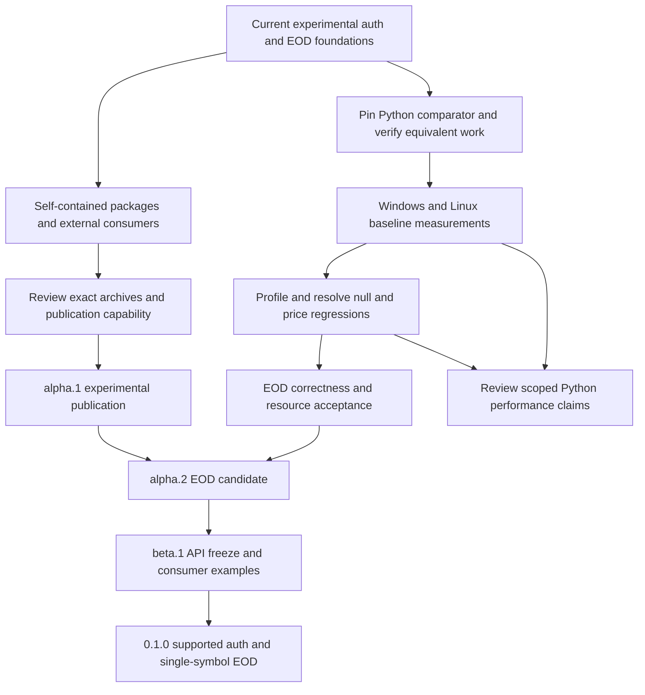

# Release milestones

Status: selected release plan, 2026-10-04. These are ordered, gate-based targets,
not published versions or calendar promises. The workspace's
`0.1.0-alpha.1` is the first, experimental prerelease, enabled for manual,
owner-approved crates.io publication. Preserve the independent Python baseline
in the [protocol manifest](../crates/praevis-thetadata-proto/schema/manifest.json).

The first supported release was planned to cover authentication and one stock EOD
slice. On 2026-11-10 the user widened it to the
[beta.1 scope](#beta1-scope-record-user-2026-11-10).
Generated bindings for 100 RPCs (Python 1.0.17 baseline) do not make 100 supported features. Every release
must state its supported surface and distinguish experimental raw bindings.
Maintainers own release decisions; client/core owners own EOD acceptance;
the account holder operates the optional live checks.

## Ordered release train

| Target | Concrete deliverable | Exit gates | Depends on / remaining work |
| --- | --- | --- | --- |
| `0.1.0-alpha.1` | **Released 2026-11-02 UTC** ([publication record](crates-io-release-plan.md#publication-record-010-alpha1), tag `v0.1.0-alpha.1`). Useful first publication of auth, core, proto, client and CLI; client EOD clearly experimental | Proto bindings and research at the current reviewed upstream baseline (1.0.17, [update plan](upstream-update-1.0.17.md), decision D5); self-contained archives and licenses; dependency versions/order; Windows/Linux external consumer builds; verified registry owner/publish capability; manually recorded PROD auth and small EOD result, or explicit documented service blocker before reconsidering scope (**met 2026-11-01**: Windows PROD auth with in-memory/`--save`/status/logout lifecycle, AAPL EOD capture/replay matching on all three interfaces, FREE quote denial; [observations](research/live-observations.md#alpha1-prod-exit-gate-2026-11-01)); exact archive review and publication approval | [Packaging plan](crates-io-release-plan.md), [manual live verification](live-verification.md). No empty placeholder crates. |
| `0.1.0-alpha.2` | EOD feature-complete candidate: exact numeric delivery and Table adapter, bounded lifecycle and documented real-service behavior | Close every applicable clause in the [EOD matrix](requirements/stock-eod-matrix.md); resolve measured null/price regressions or approve a measured per-workload tradeoff; calibrate resource defaults; compare authorized live captures with all three local interfaces; record unresolved service semantics explicitly. **Released 2026-11-03 UTC** ([publication record](crates-io-release-plan.md#publication-record-010-alpha2), tag `v0.1.0-alpha.2`); all five gates met 2026-11-02 ([readiness record](#alpha2-readiness-record-2026-11-02)) | Alpha.1. Release follows the approved [release procedure](#alpha2-release-procedure-pending-approval). |
| `0.1.0-alpha.3` | **Released 2026-11-08** ([publication record](crates-io-release-plan.md#publication-record-010-alpha3), tag `v0.1.0-alpha.3`; wheels on the [GitHub release](https://github.com/Praevis-Quant/praevis-thetadata/releases/tag/v0.1.0-alpha.3), not PyPI). The hardening work plus everything built since alpha.2 (generated endpoints, `query()`/`job()`, the scheduler, the arrow and stream crates, the schema registry), still experimental. See the [scope record](#alpha3-scope-record-2026-11-08) | Deferred items 1-4, 6 and 7 closed; item 8 open by user decision A (a beta.1 / `0.1.0` gate); packaging rehearsal green on Windows and Linux; abi3 wheels built and smoke-imported in CI; published after the user's approval | Alpha.2. Next: beta.1 (API freeze), with items 5 and 8 |
| `0.1.0-beta.1` | **API freeze of the [beta.1 scope](#beta1-scope-record-user-2026-11-10)** (user decision 2026-11-10): auth, core, arrow (with the Parquet sink), the client's `query()`/`job()`, scheduler, `RequestOptions` and generated endpoints, the Python package (vendor-named methods plus `query`/`batches`/`to_parquet`), and the auth CLI (commands, flags, exit codes and JSON output). The stream crate stays experimental; raw gRPC access and the proto crate stay low-level and unstable. Runnable consumer examples and troubleshooting | The [API-freeze checklist](#beta1-api-freeze-checklist): ADRs accepted, revised or superseded; requirement-to-test/evidence review of the frozen surface; partial-result and cancellation examples; install/build outside the workspace; supported platforms, native-store prerequisites, resource policy and compatibility boundaries documented; error categories reviewed against service semantics. Deferred items 5 and 8 are done | Alpha.3; release review covers API stability, packaging and diagnostics. No publish or tag without the user's approval |
| `0.1.0` | Supported auth + single-symbol stock EOD libraries and auth CLI | No unresolved blocker for the declared surface; green synthetic Windows/Linux checks; maintainer-reviewed manual PROD report on the release candidate; retained benchmark comparison and calibrated acceptance decision; signed-off release checklist below; **every item in [Deferred from alpha.2](#deferred-from-alpha2) closed** | Beta.1. This is not full Python parity and makes no flat-file/real-time promise. |
| `0.2.0` | Typed stock discovery, snapshots, OHLC/trade/quote history and at-time slices, delivered in small prereleases | Define per-slice ADRs and L1/L2/L3 first; reconcile inventory entries, wire presence, bounded output and account entitlements; synthetic/fault tests, optional manual live evidence and before/after data-path benchmarks for each newly supported slice | Stable first slice; select endpoint order from consumer needs. Raw bindings remain experimental until individually accepted. |
| `0.3.0` | Typed option/index slices, calendars and interest-rate history | Explicit option-contract identity, expiration/strike semantics, precise values and endpoint-specific output/resource requirements; each selected inventory item gains implementation and verification links | Stock patterns established; research unresolved contracts before implementation. Publish the exact supported endpoint list. |
| `0.4.0` | Flat-file downloads as a separately bounded interface | Dedicated ADRs for signed URLs, download lifecycle, retries/resume, integrity, credentials, storage and cancellation; entitlement verification; fault injection and manual service checks | Do not route manifests through the table decoder. Corporate-action support requires separate source/contract evidence before selection. |
| `0.5.0` | Real-time subscription interface, subject to supported vendor contracts | Explicit session/subscription lifecycle, reconnect/gap semantics, ordering, slow-consumer policy and resource budgets; deterministic mocks and limited authorized live checks | No inferred token refresh/revocation; obtain evidence for transport and subscription contracts first. |
| `1.0.0` | Stable declared Rust API and compatibility matrix | Every upstream inventory item has a reviewed supported/excluded/unresolved disposition; all advertised features accepted; migration/versioning policy; repeatable release and performance evidence; resolve any blocker to a full-parity claim before making one | The preceding versions may expose deliberate subsets. A stable API alone does not prove complete Python equivalence. |
| Separate PyO3 `0.1.0` | Python adapters over stabilized Rust interfaces | Binding ADRs/requirements, ownership/async/error/cancellation contracts, packaging/platform tests, copy/allocation and Python-transfer benchmarks | Separate project after Rust interfaces stabilize; keep Python outside core/auth/client dependencies. |

## Beta.1 scope record (user, 2026-11-10)

The user decided to proceed to beta.1 with this freeze scope.

**Frozen:**
- `praevis-thetadata-auth`;
- `praevis-thetadata-core`;
- `praevis-thetadata-arrow`, including the Parquet sink;
- `praevis-thetadata-client`: `query()`, `job()`, the scheduler,
  `RequestOptions` and the generated endpoints;
- the Python package: the vendor-named methods, plus `query`, `batches` and
  `to_parquet`.

**What "frozen" means before 1.0:** no breaking change without a deliberate
new prerelease version and release notes.

**Not frozen:**
- **`praevis-thetadata-stream` stays experimental.** Linux evidence is
  pending, and the event sequence (#136) is held.
- **Raw gRPC access stays low-level and unstable:** `stream_raw`,
  `raw_client` and `RawStream`. They expose tonic types.

**Added by the Coordinator's decisions (2026-11-11):**
- **`praevis-thetadata-cli` is frozen:** its commands, flags, exit codes and
  JSON output.
- **`praevis-thetadata-proto` stays unstable.** It exposes generated tonic
  types, the same reason as raw gRPC access.

## Deferred from alpha.2

These were deliberately deferred out of alpha.2 by the maintainer's decisions
on 2026-11-02. They are listed once here so none is lost. Each must be closed
in the named milestone and is a `0.1.0` exit gate.

| # | Item | Source requirement / decision | Target milestone |
| ---: | --- | --- | --- |
| 1 | Transport (HTTP/2) and ZSTD C-allocator memory profiling: receive buffers, libzstd allocations, fragmentation and process RSS on Windows/Linux under the calibration workloads. Until done, only the client's own accounted allocations may be called bounded. | EOD-L3-023; D-C | **Closed 2026-11-03** (alpha.3 A7, D-H): OS counters plus `ZSTD_sizeof_DCtx` on Windows, Linux x86_64 and aarch64 ([record](performance/eod-memory-profile.md)). libzstd fits the accounting; transport buffering does not (item 8) |
| 2 | Exhaustive adversarial decoder corpus beyond the alpha.2 bounded corpus: systematic and generated malformed, oversized and amplification inputs for both decoders and the envelope parser. | EOD-L3-021; D-C | **Closed 2026-11-03** (alpha.3 A6, D-G): plain-Rust corpus with differential oracles; short run in CI, long run manual. Coverage-guided fuzzing is on the ROADMAP for after 0.1.0 |
| 3 | Synthetic trusted-TLS success fixture. alpha.2 relies on live PROD TLS evidence plus the plain-HTTP rejection and stalled-handshake tests. | EOD-L3-005; D-D(b) | **Closed 2026-11-03** (alpha.3 A5, D-F b): certificates generated per test with the dev-only `rcgen` (ring backend), no committed key, private test seam; untrusted-issuer and wrong-name rejection |
| 4 | Exhaustive controlled-clock deadline/idle/cancellation interleavings, with the internal fake-transport seam in `eod.rs` that they require (a paused tokio clock cannot drive the real loopback transport). | EOD-L3-019; D-E | **Closed 2026-11-03** (alpha.3 A4): internal `Source` seam and paused-clock interleavings; neutral against the D-B tolerances ([results](performance/eod-clock-seam-results.md)) |
| 5 | Numeric comparison/ordering helper for `Price`. Equality is representational and documented since alpha.2. | User decision, 2026-11-02 | **Done for beta.1:** `Price::numeric_cmp` and `numeric_eq`, exact for any exponents. `Ord` is deliberately not implemented, because it would disagree with representational `Eq` |
| 6 | Three-round A/A on the maintainer's Ryzen desktop, to replace its provisional 1.10/0.90 tolerances. | PERF-L3-008; D-B | **Closed 2026-11-03** (alpha.3 A3): no every-round shift above 0.3%; desktop tolerances are now 1.05/0.95 ([record](performance/eod-desktop-aa-results.md)) |
| 7 | Drop an abandoned worker's schema lease before its job permit (today the result tuple releases the job permit first). The release order becomes deterministic, so a newly admitted job never observes a stale schema lease. It is a data-path change, so it needs the before/after [benchmark protocol](performance/benchmark-policy.md). | EOD resource leases; [#34](https://github.com/Praevis-Quant/praevis-thetadata/pull/34) root cause | **Closed 2026-11-03** (alpha.3 A2): `JobLeases` ordering; neutral against the D-B tolerances ([results](performance/eod-lease-order-results.md)) |
| 8 | **Proposed 2026-11-03; needs a maintainer decision.** Transport buffering outside the shared budget: each concurrently open stream holds about one full encoded message (measured up to 618 MiB resident at 16 streams × 24 MiB; at the defaults, 16 × 64 MiB could exceed 1 GiB). `concurrent_streams` bounds it linearly. The maintainer rejected a cap (2026-11-03) and asked for the root cause first. **Investigation done:** it is tonic's per-RPC decode buffer, retained for the stream's lifetime. The design alternatives are measured, and own message framing (option 2a) is recommended ([record](performance/eod-transport-buffering.md)). | EOD-L3-023; [memory profile](performance/eod-memory-profile.md) | **Closed 2026-11-10** under decision A's beta.1 gate. Option 2a on both callers (#129) and a query-path bound test (#130); real messages at most 0.36 MiB (`opt-msgsize-001`). The bound: the Rust heap on `query()`/`job()` and the stock EOD stream is bounded by configuration, plus up to streams × `encoded_bytes` for messages being assembled, held only while they are in flight ([closure](performance/eod-transport-buffering.md#closure-2026-11-10-under-decision-as-beta1-gate)) |

## Alpha.3 scope record (2026-11-08)

**Decisions (user, 2026-11-07):**
1. Prepare `0.1.0-alpha.3`.
2. **crates.io only.** The Python package does **not** go to PyPI this
   time. Its abi3 wheels (Windows and Linux) are attached to the GitHub
   release as assets.
3. Nothing is published or tagged until the user explicitly approves it at
   the end. The user runs `cargo publish` locally, as for alpha.1 and
   alpha.2.

### What alpha.3 ships since alpha.2

Everything below is **experimental**. A generated binding or a passing live
check is not a supported-feature promise; the supported surface stays auth
and the stock EOD slice until beta.1 freezes an API.

| Area | What | Evidence |
| --- | --- | --- |
| Endpoints | Generated typed requests for all 100 RPCs; the 81 with a vendor wrapper keep the vendor's defaults and presence rules (`endpoints::*`) | [Endpoint coverage](endpoints/coverage.md) |
| Queries | `ThetaClient::query()` streams exact Arrow batches; `job()` splits by date and, for all-strike fine option quotes, by strike, with ordered read-ahead; `SessionEnded` for `UNAUTHENTICATED` | [Options phase](architecture/options-phase.md) |
| Scheduling | A tier-aware scheduler: PRO 8 concurrent; FREE 1 and 20 per minute by default; overridable | [P1 design](architecture/p1-design.md) |
| Arrow and Parquet | **New crate `praevis-thetadata-arrow`:** the columnar decoder (exact decimal prices, zone-aware millisecond timestamps), the Parquet sink (no decimal statistics by default; upstream arrow-rs#12027) and registered column kinds for 59 endpoints | [ADR-0009 addendum](adr/0009-market-data-values-and-schema.md), [schemas](endpoints/schemas.json) |
| Real time | **New crate `praevis-thetadata-stream`:** option quotes and the full trade stream from an operator-run Theta Terminal's local WebSocket, parsed without allocation; it unsubscribes on close | [ADR-0018](adr/0018-explicit-connection-adapters.md) (W10 measured on the dev feed; option quotes and the full trade stream, midday and across the close run-up, also on the live market, 2026-11-10, Windows) |
| Options PRO evidence | 50 of 51 option RPCs value-checked live; the D2 targets met against the vendor package; memory bounded by configuration on the streaming path | [Options phase](architecture/options-phase.md), [D2 results](performance/options-d2-results.md) |
| Hardening | Deferred items 1-4, 6 and 7 (table below) | [Deferred from alpha.2](#deferred-from-alpha2) |
| Python | The `praevis_thetadata` package (vendor-named methods, Arrow results, Parquet) as **wheels attached to the GitHub release**, not on PyPI | [Python README](../crates/praevis-thetadata-py/README.md) |

### The items deferred from alpha.2

| # | Item | Disposition for alpha.3 |
| ---: | --- | --- |
| 1 | Transport and ZSTD memory profiling | **Done** 2026-11-03 ([record](performance/eod-memory-profile.md)) |
| 2 | Exhaustive adversarial decoder corpus | **Done** 2026-11-03 (plain-Rust corpus; fuzzing after 0.1.0, ROADMAP) |
| 3 | Synthetic trusted-TLS fixture | **Done** 2026-11-03 |
| 4 | Controlled-clock interleavings and the transport seam | **Done** 2026-11-03 ([results](performance/eod-clock-seam-results.md)) |
| 5 | Numeric comparison/ordering helper for `Price` | **Pushed to beta.1.** It is a public API decision, so it belongs with the API freeze; alpha.3 does not change `Price` |
| 6 | Desktop A/A tolerances | **Done** 2026-11-03 (1.05/0.95, [record](performance/eod-desktop-aa-results.md)) |
| 7 | Deterministic schema-lease/job-permit release order | **Done** 2026-11-03 ([results](performance/eod-lease-order-results.md)) |
| 8 | Transport buffering outside the shared budget | **Decision A (user, 2026-11-08): alpha.3 ships with item 8 open.** It stays a gate for beta.1 / `0.1.0`. **Closed 2026-11-10** for beta.1 (see the deferred table above) |

### Item 8: decision A (user, 2026-11-08)

**Decided: A.** The user approved publishing alpha.3 on 2026-11-08 with
item 8 open.
- **Gate:** it stays a gate for beta.1 / `0.1.0`.
- **Wording:** everywhere, keep "only the client's own accounted
  allocations are bounded", and name tonic's per-stream message buffer
  next to every stated ceiling.
- **Superseded:** this replaces the 2026-11-03 decision that alpha.3 wait
  on item 8.

The analysis the decision was made on:

**The 2026-11-03 decision.** The user made alpha.3 wait on item 8, and asked
for the root cause and design alternatives rather than a cap: HTTP/2
windows, streaming decode, zero-copy, and admission reservation.

**The root cause and alternatives**
([record](performance/eod-transport-buffering.md)):
- **Root cause:** tonic's per-RPC decode buffer keeps about one encoded
  message per open stream for the stream's lifetime.
- **Alternatives measured:**
  - **1, smaller windows:** no effect on the buffer.
  - **3, zero-copy payload:** no peak change.
  - **4, admission reservation:** it bounds memory by lowering concurrency.
  - **2b, streaming decode:** not prototyped, high complexity.
  - **2a, our own message framing:** recommended. Peak 128 MiB against 501
    MiB at 16 streams of 24 MiB messages, in about 60 lines, with no public
    API change. The benchmark gate was neutral (Linux 11-17% faster on
    large messages, Windows up to about 8% slower in some cases).
- **Status:** 2a stayed on hold under the performance plan, to be absorbed
  into the columnar path.

**What was learned since:**
- **Not absorbed yet.** The new `query()`/`job()` path still receives
  through `tonic::Streaming` with our codec, so tonic's buffer is still
  there: up to one message of at most `encoded_bytes` (64 MiB by default)
  per open stream.
- **The W5 memory record was incomplete.** Its stated worst case (the
  read-ahead, decoders, stream windows and one row group) left out this
  term. At PRO's 8 streams that is up to 8 × 64 MiB = 512 MiB more in the
  worst case. The record is corrected in this PR.
- **The observed heap includes it:** the W5 runs' counting allocator saw
  everything, and peaked at 103-182 MiB over 7 live runs of up to 26.6M
  rows. Real messages are far below the 64 MiB limit.
- **Unrelated memory problems were separate root causes:**
  - The Parquet growth was the parquet 60.1 decimal-statistics bug
    (arrow-rs#12027), not transport. It is worked around by default.
  - The read-ahead is bounded by configuration.

**The options for alpha.3:**

| Option | What | Cost | Effect on the bound |
| --- | --- | --- | --- |
| **A. Ship alpha.3 with item 8 open, moved to beta.1** | Keep "only accounted allocations are bounded" everywhere, document the per-stream message term next to every ceiling, and resolve it before the beta.1 API freeze | none now | The stated ceilings stay accounted-only, with the tonic term named explicitly |
| **B. Hold alpha.3 for option 2a** | Implement 2a in the `query()` and EOD paths (from `exp/transport-own-framing`), add a bound test, and run the before/after benchmark protocol and the memory runner on Windows and Linux | about 2 PRs plus a benchmark cycle; alpha.3 waits for the results | Memory bounded by configuration, including transport, pending the bound test |
| **C. Hold alpha.3 for 2b** | Streaming decode into the Arrow builders | high; a new incremental parser over adversarial input | As B, minus about one message per active job |

**Recommendation: A.**
- **Why ship now:** alpha.3 is an experimental prerelease. The gap is now
  documented precisely, with the wording kept, and real messages are
  small. Whether 2a still costs up to 8% on Windows should be measured on
  the new path without blocking the release.
- **When to choose B instead:** if you want alpha.3 to claim a
  configuration-bounded total for the query path.

**The user chose A** on 2026-11-08 and approved publication.

**Closed for beta.1 on 2026-11-10.**
- **What landed:** option 2a on both callers (#129) and the query-path bound
  test (#130).
- **The measured messages:** real ones are at most 0.36 MiB
  (`opt-msgsize-001`).
- **The bound now stated:** the Rust heap on `query()`/`job()` and the stock EOD stream is bounded by configuration, plus up to streams × `encoded_bytes` for messages being assembled, held only while they are in flight. That's 8 × 64 MiB in the worst case at PRO, and about 3 MiB at
  observed sizes. It is not process RSS and not `stream_raw`.
- **Held:** byte credits, until real messages reach the tens of MiB.
- **Kept:** `encoded_bytes` stays at 64 MiB
  ([closure](performance/eod-transport-buffering.md#closure-2026-11-10-under-decision-as-beta1-gate)).

### Crates and the publish set

Published in dependency order, each at `0.1.0-alpha.3`. Names checked on
crates.io on 2026-11-08: the two new names are free.

| Order | Crate | crates.io | Packaging status (step b) |
| ---: | --- | --- | --- |
| 1 | `praevis-thetadata-proto` | published (alpha.2) | ready |
| 2 | `praevis-thetadata-core` | published (alpha.2) | ready |
| 3 | `praevis-thetadata-auth` | published (alpha.2) | ready |
| 4 | `praevis-thetadata-arrow` | **new**, name free | **Done:** `publish = false` lifted (the client depends on it); `documentation` added; LICENSE, NOTICE and README present |
| 5 | `praevis-thetadata-client` | published (alpha.2) | **Done:** description updated for the new surface |
| 6 | `praevis-thetadata-cli` | published (alpha.2) | ready. The description fix already shipped with alpha.2 (crates.io shows "in-memory login, with opt-in (auth --save) ... storage") |
| 7 | `praevis-thetadata-stream` | **new**, name free | **Done:** `publish = false` lifted; LICENSE and NOTICE copies, `documentation`, keywords, categories and an `examples/` exclusion added; in the package-file check. No internal dependencies (the client is a dev-dependency only), so it publishes last |
| — | `praevis-thetadata-py` | **stays unpublished** (`publish = false`) | Built as abi3 wheels in CI; attached to the GitHub release |

Steps:
- **a.** This record.
- **b.** Version bump, the CHANGELOG release section, the publication
  checklist and order, and the metadata fixes above.
- **c.** A packaging rehearsal on Windows and Linux for every published
  crate, abi3 wheels with a smoke import, and the archive contents
  reviewed.
- **d.** A GitHub release draft, not published:
  [draft text](release-draft-0.1.0-alpha.3.md).

Later version scopes are planning allocations, not approval of undocumented
vendor behavior. Split a milestone into additional prereleases when its evidence
is incomplete; change the plan explicitly rather than silently dropping features.
Initially version the five workspace crates together. A future independent
crate-version policy needs a release decision and dependency compatibility plan.

Optional Terminal track: target a first REST EOD adapter for an operator-started
v3 JAR in the `0.2.0` prereleases, with explicit HTTP/value/resource contracts and
manual per-tier evidence under [ADR-0018](adr/0018-explicit-connection-adapters.md).
Target process supervision only after attached-process behavior is accepted;
keep WebSocket subscription work in the `0.5.0` event milestone. Do not delay or
add Java to direct auth/EOD users. Every release records available and not-run
product/tier/connector cells in the [subscription matrix](subscription-testing.md).

## Immediate execution order

Start with alpha.1 packaging and a reproducible Python comparison baseline.
The upstream baseline update to Python 1.0.17 ([plan](upstream-update-1.0.17.md))
landed before alpha.1 publication, as decision D5 requires: research (#15),
tooling (#16), baseline (#17), timestamp precision (#18) and documentation.
The first published `praevis-thetadata-proto` therefore carries the 1.0.17
schema rather than the earlier 82-RPC schema.
The sixteen-column synthetic EOD regression corpus and the Praevis ThetaData
naming decision are complete at `1899725`; archive readiness and performance
acceptance are still open. Existing timings compare Rust implementations, not
the vendor Python package. The [Python comparison plan](performance/python-comparison.md)
defines the evidence needed before advertising an advantage over Python.

The Python comparison is a selected demonstration objective. It does not add an
unmeasured universal-speedup condition to alpha.1 or replace the existing EOD
acceptance gates. If a workload shows no advantage, retain that result and
limit the claim. A faster decoder alone does not close a correctness gate.

| Order and owner | Concrete next change | Completion evidence | Milestone |
| --- | --- | --- | --- |
| 1. Release maintainer | Add the four missing library READMEs, archive licenses/NOTICE, registry dependency versions and self-contained client build inputs; decide internal benchmark/manual-runner archive inclusion | Reviewed five-package file lists and extracted archives; no sibling checkout dependencies; candidate hashes | alpha.1 preparation |
| 2. Release maintainer | Rehearse first-wave then dependent packaging in an isolated staging registry; build/install external consumers on Windows and Linux | Archive builds, consumer logs and dependency resolution from outside the workspace; name/owner/token capability checks recorded without secrets | alpha.1 exit |
| 3. Performance maintainer, alongside packaging | Implement the pinned Python comparator and common fixture/output checks described in the comparison plan | Hash-verified artifact and dependency lock, harness provenance, passing semantic checks, repeatable local commands; no performance claim yet | Demonstration baseline |
| 4. Client/core owners | Measure the unchanged Rust candidate against Python and the retained Rust control; profile null/price costs, then change one cause at a time | Repeated Windows/Linux per-workload latency, throughput and process-memory reports; equivalent outputs and all regressions retained | alpha.2 performance evidence |
| 5. Client/core owners | Close remaining EOD matrix clauses and resource calibration | Dependency-log/session/URL sentinels, timeout metadata, controlled-clock interleavings, timestamp boundaries, partial-result example, text/header extremes and supported query-cap range; transport/C allocation measured separately | alpha.2 acceptance |
| 6. Account holder and maintainer | Select bounded additional live EOD date/schema/empty-result cases and available tier checks | Explicit query/credential selection, private capture hashes, raw/numeric/Table replay and reviewed observations; unavailable paid tiers remain not-run | Live evidence for declared scope |
| 7. Maintainers | Review the exact alpha.1 artifacts for publication; later review EOD acceptance and API freeze | Publication approval after archive/consumer checks; alpha.2 evidence decision; beta examples and accepted/revised ADRs; final release checklist | alpha.1, then alpha.2, beta.1 and 0.1.0 |

Rows 1-2 are implemented: metadata, READMEs, license copies and versions
(part A), and self-contained archives with a Windows/Linux staging rehearsal
and external consumers (part B). They were rebased on the ADR-0020 auth model.
What remains for rows 1-2 is the owner's token/owner review, the final name
check and the publication approval listed in the
[crates.io plan](crates-io-release-plan.md#remaining-before-publication-owner-decisions).
Row 3 is an independent benchmark PR.
Run row 4's baseline before optimizing. Complete row 5 against the
[acceptance matrix](requirements/stock-eod-matrix.md), retaining its per-clause
evidence. Select row 6 from the [subscription matrix](subscription-testing.md);
live checks remain manual and outside CI. Alpha.1 can precede rows 4-5, with
experimental scope stated in its release notes. Publish no comparative numbers
until the comparator, outputs and measurement boundaries have been reviewed.

## Status: alpha.2 released, next target alpha.3

`0.1.0-alpha.1` was released on 2026-11-02 UTC. Every checklist row below has
alpha.1 evidence:

- archives: staging rehearsal and published checksums;
- scope: the 1.0.17 baseline and ADR-0020;
- correctness: Windows/Linux CI;
- live interoperability: the PROD exit gate;
- installs and consumers from crates.io on Windows and Linux.

All five `0.1.0-alpha.2` exit gates were met on 2026-11-02, as recorded below.
`0.1.0-alpha.2` was released on 2026-11-03 UTC, following the approved
procedure ([publication record](crates-io-release-plan.md#publication-record-010-alpha2)).
The **next target is the proposed `0.1.0-alpha.3`** hardening milestone. Execution-order rows 4-6 are complete for alpha.2. Row 3, the pinned
Python comparator, remains a separate follow-up and is not an alpha.2 gate.

## Alpha.2 readiness record (2026-11-02)

The candidate is `main` after this record. Workspace tests and the packaging
rehearsal pass on Windows and Linux CI.

| Gate | Evidence | Status |
| --- | --- | --- |
| 1. Close every applicable EOD matrix clause | [Matrix disposition](requirements/stock-eod-matrix.md#alpha2-disposition-2026-11-02): 24 closed, 5 closed with a named deferral, 1 not applicable by decision D-E, **0 open** (#31, #32, #33, #35) | Met |
| 2. Resolve the null/price regressions | Per-cell hand decoder with prost-identical semantics (#29). On the x86 runners, decode is faster against the previous `main` by 21-36% for nulls, 8-16% for mixed and 6-12% for prices. Confirmed on the maintainer's Ryzen; accepted 2026-11-02 ([results](performance/eod-decoder-results.md)) | Met |
| 3. Calibrate resource defaults | Defaults kept by maintainer decision; effective ceilings and the 16-stream cap measured on Windows/Linux runners ([calibration](performance/eod-calibration.md), #30). Tolerances approved as D-B ([policy](performance/benchmark-policy.md)); the desktop values are provisional (item 6) | Met |
| 4. Compare authorized live captures with all three local interfaces | Seven PROD/FREE runs at `39bc601`. All four data runs match value-for-value across numeric, Table and raw replay ([observations](research/live-observations.md#alpha2-prod-service-semantics-runs-2026-11-02)) | Met; re-replay on the release commit (below) |
| 5. Record unresolved service semantics explicitly | [EOD-L3-029 semantics table](requirements/stock-eod-evidence.md#observed-service-semantics-eod-l3-029): 20 semantics, each observed or unresolved | Met |

Also completed for alpha.2:

- The CLI package description now says persistence is opt-in (#28). This
  closes the [alpha.1 follow-up](crates-io-release-plan.md#publication-record-010-alpha1).
- Windows before/after benchmark evidence (#28, #29).
- Dependency-log, session and URL sentinels (#32, #33).
- Timestamp range cap, partial-result example and the bounded mutation corpus (#31).

**Caveat for gate 4.** The captures were made at `39bc601`. That is before the
cell decoder (#29), the year-9999 timestamp cap (#31) and endpoint URL
validation (#32). Offline replay of the retained captures on the release commit
needs no credentials. It must reproduce the recorded semantic hashes before
publication (procedure step 3).

**Behavior changes since alpha.1**, for the release notes:

- Endpoint URLs with credentials, a query or a fragment are rejected.
- Timestamps after 9999-12-31 are rejected rather than formatted as `+10000-…`.
- `MAX_EPOCH_MS` and `check_timestamp_range` are new public items in core.
- Decoding is faster. Its preflight, limits and error categories are unchanged.

Deferred items 1-7 below are **not** alpha.2 gates. Items 1-4, 6 and 7 are
proposed for alpha.3; item 5 belongs to the beta.1 API freeze.

### Alpha.2 release procedure (pending approval)

Approved by the user on 2026-11-02 as one decision; **executed 2026-11-03** (#37, tag `v0.1.0-alpha.2`, [publication record](crates-io-release-plan.md#publication-record-010-alpha2)).

1. **Version-bump PR.**
   - Set `version = "0.1.0-alpha.2"` in the root `Cargo.toml`, and the four
     `=0.1.0-alpha.2` internal dependency pins.
   - Refresh `Cargo.lock` (five package versions).
   - Update the version and install lines in the root README, the five package
     READMEs and `AGENTS.md`.
   - Update the `=0.1.0-alpha.2` pins in `tools/release-consumers/*` and in
     `tools/test_staging_registry.py`.
   - In the CHANGELOG, retitle `[Unreleased]` as `## [0.1.0-alpha.2] - <UTC publication date>`
     and open a new empty `[Unreleased]` section.
   - Mark alpha.2 as released in `releases.md` and the ROADMAP.
   - No API or code change.
2. **CI on the bump PR.** Verify and Packaging rehearsal must pass on Windows
   and Linux. The rehearsal builds the five archives at the new version,
   stages them in wave order, builds the external consumers and installs the CLI.
   Review its per-package file lists, hashes and license/NOTICE check.
3. **Offline replay on the merged bump commit** (maintainer, Windows, no
   credentials). Run `live_eod replay` for `prod-aapl-range-a2-001`,
   `prod-msft-a2-001` and `prod-nvda-split-a2-001`, plus `prod-aapl-alpha1-002`.
   The semantic hashes must equal the recorded ones, with `matches: true` on
   all three interfaces. A fresh small PROD run on the candidate is optional.
4. **Publish from that commit**, in the alpha.1 wave order, each step waiting
   for index availability:
   1. `praevis-thetadata-auth`, `praevis-thetadata-core`, `praevis-thetadata-proto`;
   2. `praevis-thetadata-client`;
   3. `praevis-thetadata-cli`.

   This is a manual `cargo publish` by the owner, with the token never in
   argv or logs.
5. **Annotated tag** `v0.1.0-alpha.2` on the published commit, plus release notes:
   - the CHANGELOG section;
   - the behavior changes above;
   - links to this record and to the deferred block.
6. **Post-publication checks** on Windows and Linux:
   - `cargo install praevis-thetadata-cli --version 0.1.0-alpha.2 --locked`
     prints the version;
   - the crates.io-only consumers build;
   - downloaded `.crate` hashes match the registry;
   - docs.rs builds.

   Record all of this in a "Publication record: 0.1.0-alpha.2" section of the
   [crates.io plan](crates-io-release-plan.md), as for alpha.1.

### Beta.1 API-freeze checklist

Every item must be reviewed before the [beta.1 scope](#beta1-scope-record-user-2026-11-10)
is frozen at `0.1.0-beta.1`.

- [x] **Transport buffering (deferred item 8), closed 2026-11-10.** The bound:
      the Rust heap on `query()`/`job()` and the EOD stream is bounded by
      configuration, plus streams × `encoded_bytes` while messages are in
      flight. It is tested by #130; real messages are at most 0.36 MiB.
- [x] **`Price` numeric comparison/ordering helper** (deferred item 5).
      - **Added:** `Price::numeric_cmp` (use with `sort_by`) and
        `numeric_eq`, exact for any exponents.
      - **Unchanged:** equality stays representational, with per-value scale.
      - **No `Ord`:** a value ordering that disagreed with `Eq` would break
        sorted collections.
- [x] **Room to grow without breaking (user-approved API change 1 of 5,
      2026-11-08).** The rules:
      - **Enums are `#[non_exhaustive]`:** every public error, kind, status and
        policy enum (`QueryError`, `DecodeError`, `SinkError`, `AuthError`,
        `StoreError`, `DataError`, `StreamError`, `Kind`, `Status`, `Response`,
        `Overflow`, `Tier`, `Split`, `Stability`, `Expiration`, `TimeOfDay`,
        `ColumnKind`, `Credentials`, `Environment`, `Value`, `BatchValue`,
        `TimeZone`, `Error` and `ParquetOutputError`).
      - **Output structs are `#[non_exhaustive]`:** `User`, `ParquetSummary`,
        `Stats`, `Quote`, `Trade`, `Event` and `EndpointInfo`.
      - **Configuration structs are `#[non_exhaustive]` with one `with_<field>`
        setter per field:** `ClientConfig`, `BatchPolicy`, `EodPolicy`,
        `SchedulerPolicy`, `DecodeLimits`, `ParquetOptions`, `Limits`,
        `AuthConfig` and the stream's `Options`. Build them with
        `Type::default().with_x(…)`. Assigning a field after `default()` also
        still works.
      - **All 100 generated requests are `#[non_exhaustive]`.** Wrapper
        requests already had `new` and builders; descriptor-only requests now
        get one setter per field.
      - **Deliberately left plain:**
        - `Right` (an option is only ever a call or a put);
        - the value types `Contract`, `Root` and both `Price` types, whose
          shape is fixed by what they are;
        - `Table`, the complete legacy shape;
        - structs with only private fields, which are already closed.
- [x] **Per-call request options (API change 4 of 5).** `RequestOptions`
      replaces `BatchPolicy` as the argument of `query_with` and `job_with`.
      It holds the batch policy, an overall timeout, an idle timeout, and a
      per-job concurrency of at most the scheduler's. **The timeout covers
      queue time** (the documented and tested decision).
- [x] **Stream handles (API change 3 of 5):** `Stream::split()` gives a
      clonable `Send + Sync` `StreamControl` and the single `StreamEvents`
      receiver. Close semantics are unchanged.
- [x] **`Endpoint` is sealed (API change 2 of 5).** Only the generated
      requests implement it, so the trait can gain items. Nothing outside the
      crate needs to implement it: a request is a vendor RPC with its exact
      wire mapping.
- [x] **ADRs accepted, revised or superseded** (2026-11-11,
      [index](adr/README.md)).
      - **Accepted:** 0011, 0012 and 0015.
      - **Accepted with revisions:** 0008, 0009, 0010, 0013 and 0014.
      - **Accepted in part:** 0018 (the WebSocket adapter; it stays
        experimental).
      - **Superseded:** 0007, by the performance plan.
      - **Deferred:** 0016, never built.

      Each record ends with a short "Beta.1 review" note.
- [x] **Requirement-to-test/evidence review of the frozen surface**
      (2026-11-11, [review](requirements/beta1-evidence-review.md)). Each
      frozen area has its tests and live evidence.
      - **Gaps, listed:** 20 vendor wrappers seen only as refusals, and one
        gated; no live retry or `RequestOptions` timeout; the `NoData`
        check pending; live runs on Windows only; Python 3.12 only in CI.
- [x] **Partial-result and cancellation consumer examples** (2026-11-11).
      - **Rust:** `query_consumer` (`query()`/`job()`); its tests run in
        `cargo test`.
      - **Python:** `examples/consumer_patterns.py`, run in CI against the
        loopback service (`loopback_server`) on both platforms.
      - **The cancellation tests fail without the cancellation:** the next
        request would hit its 5 s timeout.
- [x] **Install and build outside the workspace** (2026-11-11,
      [record](crates-io-release-plan.md#install-and-build-outside-the-workspace-beta1-record-2026-11-11)).
      - **Already proven** by the rehearsal: the archives built in
        isolation, seven external consumers, and the CLI install. The
        Python job installs the wheel into a clean environment.
      - **Added:** the client consumer now covers the frozen client
        surface; the declared MSRV 1.88 is checked in CI; the clean
        environment runs `describe()` offline.
- [x] **Supported platforms, native-store prerequisites, resource policy and
      compatibility boundaries documented** (2026-11-11,
      [user guide](user-guide.md)).
      - **Platforms:** Windows x86_64 and Linux x86_64 with glibc 2.28 or
        later; macOS and ARM are not supported.
      - **Resource policy:** the item 8 bound in the wording AGENTS.md
        allows.
- [ ] Review the public error categories (`QueryError`, and `EodError` for the EOD stream; `NoData` for both no-data and unknown symbol) against the observed service semantics.
      **Reviewed 2026-11-11** (client README, "Errors"): no meaning changed.
      `NoData` stays `NOT_FOUND`, which covers both cases. One open question
      is waiting on a live run of `live_p0 not-found`: does anything but the
      vendor's text tell the two apart?

## Checklist for every release candidate

| Evidence | Owner | Required record |
| --- | --- | --- |
| Package archives | Release maintainer | `tools/staging_registry.py` report from the "Packaging rehearsal" CI job on Windows and Linux: per-package file lists, SHA-256 and bytes, license/NOTICE presence, forbidden-input check, wave-ordered staging, consumer builds outside the workspace, CLI install; the default auth and client consumers resolve no native-store packages ([record](crates-io-release-plan.md#archive-staging-rehearsal-alpha1-part-b-2026-11-01)) |
| Scope and change control | Maintainers | Version, source commit, advertised APIs, known limitations, upstream version and impact review; upstream/enhancement contracts checked separately |
| Requirements and decisions | Component owners | IDs, accepted ADR decisions, passing evidence and remaining exclusions; no gaps hidden by aggregate inventory counts |
| Correctness | Component owners | Windows/Linux synthetic tests, fault/lifecycle matrix and documentation audits; ordinary CI stays credential-free |
| Performance | Client/core owners | Common-harness before/after samples, host/toolchain/source hashes, per-shape regressions, resource policy and reviewed tolerances; live latency is observational, not a decoder benchmark |
| Live interoperability | Account holder + maintainer | Optional manually invoked PROD run on the candidate, time/environment/query, protocol/build hashes, terminal state and private response hashes, replay/comparison report and reviewed service observations; a service outage is recorded as a blocker, not success. alpha.1: recorded 2026-11-01 ([observations](research/live-observations.md#alpha1-prod-exit-gate-2026-11-01)) |
| Packaging | Release maintainer | Exact package/version list, archive hashes, licenses, self-contained build inputs, registry dependency resolution, external consumers, owner/token checks |
| Publication | Release maintainer | Approval of exact public artifacts; ordered publish, tag/release notes, registry visibility and clean install checks; no automatic first publication |

The live suite is optional to contributors and never a pipeline step. A release
maintainer runs it manually when closing a live-compatibility release gate.
Do not publish raw licensed responses, account identity, session tokens or keys
as CI artifacts or release attachments. A sanitized summary may describe
verified behavior, scope and hashes after review.

Patch releases fix the advertised surface without adding unsupported endpoint
claims. Pre-1.0 breaking API changes require release notes and a deliberate minor
or prerelease change; never silently reinterpret stable requirement IDs.
