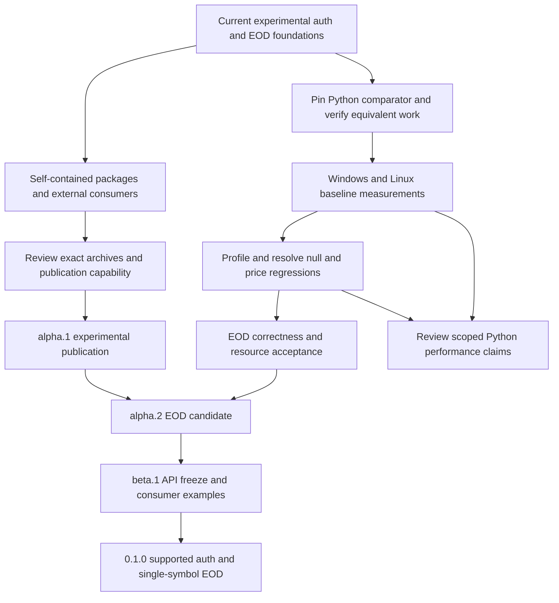

# Release milestones

Status: selected release plan, 2026-10-04. These are ordered, gate-based targets,
not published versions or calendar promises. The workspace's
`0.1.0-alpha.1` is the first, experimental prerelease, enabled for manual,
owner-approved crates.io publication. Preserve the independent Python baseline
in the [protocol manifest](../crates/praevis-thetadata-proto/schema/manifest.json).

The first supported release will cover authentication and one stock EOD slice.
Generated bindings for 100 RPCs (Python 1.0.17 baseline) do not make 100 supported features. Every release
must state its supported surface and distinguish experimental raw bindings.
Maintainers own release decisions; client/core owners own EOD acceptance;
the account holder operates the optional live checks.

## Ordered release train

| Target | Concrete deliverable | Exit gates | Depends on / remaining work |
| --- | --- | --- | --- |
| `0.1.0-alpha.1` | **Released 2026-11-02 UTC** ([publication record](crates-io-release-plan.md#publication-record-010-alpha1), tag `v0.1.0-alpha.1`). Useful first publication of auth, core, proto, client and CLI; client EOD clearly experimental | Proto bindings and research at the current reviewed upstream baseline (1.0.17, [update plan](upstream-update-1.0.17.md), decision D5); self-contained archives and licenses; dependency versions/order; Windows/Linux external consumer builds; verified registry owner/publish capability; manually recorded PROD auth and small EOD result, or explicit documented service blocker before reconsidering scope (**met 2026-11-01**: Windows PROD auth with in-memory/`--save`/status/logout lifecycle, AAPL EOD capture/replay matching on all three interfaces, FREE quote denial; [observations](research/live-observations.md#alpha1-prod-exit-gate-2026-11-01)); exact archive review and publication approval | [Packaging plan](crates-io-release-plan.md), [manual live verification](live-verification.md). No empty placeholder crates. |
| `0.1.0-alpha.2` | EOD feature-complete candidate: exact numeric delivery and Table adapter, bounded lifecycle and documented real-service behavior | Close every applicable clause in the [EOD matrix](requirements/stock-eod-matrix.md); resolve measured null/price regressions or approve a measured per-workload tradeoff; calibrate resource defaults; compare authorized live captures with all three local interfaces; record unresolved service semantics explicitly. **All five met 2026-11-02; release approved 2026-11-02, publication pending** ([readiness record](#alpha2-readiness-record-2026-11-02)) | Alpha.1. Release follows the approved [release procedure](#alpha2-release-procedure-pending-approval). |
| `0.1.0-alpha.3` (proposed) | **Hardening**: close the items deferred from alpha.2 without changing the public API | Deferred items 1-4, 6 and 7 below closed, with evidence linked from the EOD matrix and benchmark policy | Alpha.2. Proposed 2026-11-02 so the deferred work stays scheduled; it can be renamed or merged into beta.1 by maintainer decision. |
| `0.1.0-beta.1` | Freeze auth/EOD public API for the first supported release; runnable consumer examples and troubleshooting | Accept or revise the applicable proposed ADRs; requirement-to-test/evidence review; partial-result and cancellation examples; install/build outside workspace; document supported platforms, native-store prerequisites, resource policy and compatibility boundaries; **API freeze review of a numeric comparison/ordering helper for `Price`** (deferred item 5) | Alpha.2; release review covers API stability, packaging and diagnostics. |
| `0.1.0` | Supported auth + single-symbol stock EOD libraries and auth CLI | No unresolved blocker for the declared surface; green synthetic Windows/Linux checks; maintainer-reviewed manual PROD report on the release candidate; retained benchmark comparison and calibrated acceptance decision; signed-off release checklist below; **every item in [Deferred from alpha.2](#deferred-from-alpha2) closed** | Beta.1. This is not full Python parity and makes no flat-file/real-time promise. |
| `0.2.0` | Typed stock discovery, snapshots, OHLC/trade/quote history and at-time slices, delivered in small prereleases | Define per-slice ADRs and L1/L2/L3 first; reconcile inventory entries, wire presence, bounded output and account entitlements; synthetic/fault tests, optional manual live evidence and before/after data-path benchmarks for each newly supported slice | Stable first slice; select endpoint order from consumer needs. Raw bindings remain experimental until individually accepted. |
| `0.3.0` | Typed option/index slices, calendars and interest-rate history | Explicit option-contract identity, expiration/strike semantics, precise values and endpoint-specific output/resource requirements; each selected inventory item gains implementation and verification links | Stock patterns established; research unresolved contracts before implementation. Publish the exact supported endpoint list. |
| `0.4.0` | Flat-file downloads as a separately bounded interface | Dedicated ADRs for signed URLs, download lifecycle, retries/resume, integrity, credentials, storage and cancellation; entitlement verification; fault injection and manual service checks | Do not route manifests through the table decoder. Corporate-action support requires separate source/contract evidence before selection. |
| `0.5.0` | Real-time subscription interface, subject to supported vendor contracts | Explicit session/subscription lifecycle, reconnect/gap semantics, ordering, slow-consumer policy and resource budgets; deterministic mocks and limited authorized live checks | No inferred token refresh/revocation; obtain evidence for transport and subscription contracts first. |
| `1.0.0` | Stable declared Rust API and compatibility matrix | Every upstream inventory item has a reviewed supported/excluded/unresolved disposition; all advertised features accepted; migration/versioning policy; repeatable release and performance evidence; resolve any blocker to a full-parity claim before making one | The preceding versions may expose deliberate subsets. A stable API alone does not prove complete Python equivalence. |
| Separate PyO3 `0.1.0` | Python adapters over stabilized Rust interfaces | Binding ADRs/requirements, ownership/async/error/cancellation contracts, packaging/platform tests, copy/allocation and Python-transfer benchmarks | Separate project after Rust interfaces stabilize; keep Python outside core/auth/client dependencies. |

## Deferred from alpha.2

These were deliberately deferred out of alpha.2 by the maintainer's decisions
on 2026-11-02. They are listed once here so none is lost. Each must be closed
in the named milestone and is a `0.1.0` exit gate.

| # | Item | Source requirement / decision | Target milestone |
| ---: | --- | --- | --- |
| 1 | Transport (HTTP/2) and ZSTD C-allocator memory profiling: receive buffers, libzstd allocations, fragmentation and process RSS on Windows/Linux under the calibration workloads. Until done, only the client's own accounted allocations may be called bounded. | EOD-L3-023; D-C | `0.1.0-alpha.3` (hardening) |
| 2 | Exhaustive adversarial decoder corpus beyond the alpha.2 bounded corpus: systematic and generated malformed, oversized and amplification inputs for both decoders and the envelope parser. | EOD-L3-021; D-C | `0.1.0-alpha.3` |
| 3 | Synthetic trusted-TLS success fixture. alpha.2 relies on live PROD TLS evidence plus the plain-HTTP rejection and stalled-handshake tests. | EOD-L3-005; D-D(b) | `0.1.0-alpha.3` |
| 4 | Exhaustive controlled-clock deadline/idle/cancellation interleavings, with the internal fake-transport seam in `eod.rs` that they require (a paused tokio clock cannot drive the real loopback transport). | EOD-L3-019; D-E | `0.1.0-alpha.3` |
| 5 | Numeric comparison/ordering helper for `Price`. Equality is representational and documented since alpha.2. | User decision, 2026-11-02 | `0.1.0-beta.1` (API freeze) |
| 6 | Three-round A/A on the maintainer's Ryzen desktop, to replace its provisional 1.10/0.90 tolerances. | PERF-L3-008; D-B | `0.1.0-alpha.3` |
| 7 | Drop an abandoned worker's schema lease before its job permit (today the result tuple releases the job permit first). The release order becomes deterministic, so a newly admitted job never observes a stale schema lease. It is a data-path change, so it needs the before/after [benchmark protocol](performance/benchmark-policy.md). | EOD resource leases; [#34](https://github.com/Praevis-Quant/praevis-thetadata/pull/34) root cause | `0.1.0-alpha.3` |

Later version scopes are planning allocations, not approval of undocumented
vendor behavior. Split a milestone into additional prereleases when its evidence
is incomplete; change the plan explicitly rather than silently dropping features.
Initially version the five workspace crates together. A future independent
crate-version policy needs a release decision and dependency compatibility plan.

Optional Terminal track: target a first REST EOD adapter for an operator-started
v3 JAR in the `0.2.0` prereleases, with explicit HTTP/value/resource contracts and
manual per-tier evidence under [ADR-0018](adr/0018-explicit-connection-adapters.md).
Target process supervision only after attached-process behavior is accepted;
keep WebSocket subscription work in the `0.5.0` event milestone. Do not delay or
add Java to direct auth/EOD users. Every release records available and not-run
product/tier/connector cells in the [subscription matrix](subscription-testing.md).

## Immediate execution order

Start with alpha.1 packaging and a reproducible Python comparison baseline.
The upstream baseline update to Python 1.0.17 ([plan](upstream-update-1.0.17.md))
landed before alpha.1 publication, as decision D5 requires: research (#15),
tooling (#16), baseline (#17), timestamp precision (#18) and documentation.
The first published `praevis-thetadata-proto` therefore carries the 1.0.17
schema rather than the earlier 82-RPC schema.
The sixteen-column synthetic EOD regression corpus and the Praevis ThetaData
naming decision are complete at `1899725`; archive readiness and performance
acceptance are still open. Existing timings compare Rust implementations, not
the vendor Python package. The [Python comparison plan](performance/python-comparison.md)
defines the evidence needed before advertising an advantage over Python.

The Python comparison is a selected demonstration objective. It does not add an
unmeasured universal-speedup condition to alpha.1 or replace the existing EOD
acceptance gates. If a workload shows no advantage, retain that result and
limit the claim. A faster decoder alone does not close a correctness gate.

| Order and owner | Concrete next change | Completion evidence | Milestone |
| --- | --- | --- | --- |
| 1. Release maintainer | Add the four missing library READMEs, archive licenses/NOTICE, registry dependency versions and self-contained client build inputs; decide internal benchmark/manual-runner archive inclusion | Reviewed five-package file lists and extracted archives; no sibling checkout dependencies; candidate hashes | alpha.1 preparation |
| 2. Release maintainer | Rehearse first-wave then dependent packaging in an isolated staging registry; build/install external consumers on Windows and Linux | Archive builds, consumer logs and dependency resolution from outside the workspace; name/owner/token capability checks recorded without secrets | alpha.1 exit |
| 3. Performance maintainer, alongside packaging | Implement the pinned Python comparator and common fixture/output checks described in the comparison plan | Hash-verified artifact and dependency lock, harness provenance, passing semantic checks, repeatable local commands; no performance claim yet | Demonstration baseline |
| 4. Client/core owners | Measure the unchanged Rust candidate against Python and the retained Rust control; profile null/price costs, then change one cause at a time | Repeated Windows/Linux per-workload latency, throughput and process-memory reports; equivalent outputs and all regressions retained | alpha.2 performance evidence |
| 5. Client/core owners | Close remaining EOD matrix clauses and resource calibration | Dependency-log/session/URL sentinels, timeout metadata, controlled-clock interleavings, timestamp boundaries, partial-result example, text/header extremes and supported query-cap range; transport/C allocation measured separately | alpha.2 acceptance |
| 6. Account holder and maintainer | Select bounded additional live EOD date/schema/empty-result cases and available tier checks | Explicit query/credential selection, private capture hashes, raw/numeric/Table replay and reviewed observations; unavailable paid tiers remain not-run | Live evidence for declared scope |
| 7. Maintainers | Review the exact alpha.1 artifacts for publication; later review EOD acceptance and API freeze | Publication approval after archive/consumer checks; alpha.2 evidence decision; beta examples and accepted/revised ADRs; final release checklist | alpha.1, then alpha.2, beta.1 and 0.1.0 |

Rows 1-2 are implemented: metadata, READMEs, license copies and versions
(part A), and self-contained archives with a Windows/Linux staging rehearsal
and external consumers (part B). They were rebased on the ADR-0020 auth model.
What remains for rows 1-2 is the owner's token/owner review, the final name
check and the publication approval listed in the
[crates.io plan](crates-io-release-plan.md#remaining-before-publication-owner-decisions).
Row 3 is an independent benchmark PR.
Run row 4's baseline before optimizing. Complete row 5 against the
[acceptance matrix](requirements/stock-eod-matrix.md), retaining its per-clause
evidence. Select row 6 from the [subscription matrix](subscription-testing.md);
live checks remain manual and outside CI. Alpha.1 can precede rows 4-5, with
experimental scope stated in its release notes. Publish no comparative numbers
until the comparator, outputs and measurement boundaries have been reviewed.

## Status: alpha.2 approved, publication pending

`0.1.0-alpha.1` was released on 2026-11-02 UTC. Every checklist row below has
alpha.1 evidence:

- archives: staging rehearsal and published checksums;
- scope: the 1.0.17 baseline and ADR-0020;
- correctness: Windows/Linux CI;
- live interoperability: the PROD exit gate;
- installs and consumers from crates.io on Windows and Linux.

All five `0.1.0-alpha.2` exit gates were met on 2026-11-02, as recorded below.
The user approved the release on 2026-11-02. The workspace version is now
`0.1.0-alpha.2` (procedure step 1); it is not published until step 4. Execution-order rows 4-6 are complete for alpha.2. Row 3, the pinned
Python comparator, remains a separate follow-up and is not an alpha.2 gate.

## Alpha.2 readiness record (2026-11-02)

The candidate is `main` after this record. Workspace tests and the packaging
rehearsal pass on Windows and Linux CI.

| Gate | Evidence | Status |
| --- | --- | --- |
| 1. Close every applicable EOD matrix clause | [Matrix disposition](requirements/stock-eod-matrix.md#alpha2-disposition-2026-11-02): 24 closed, 5 closed with a named deferral, 1 not applicable by decision D-E, **0 open** (#31, #32, #33, #35) | Met |
| 2. Resolve the null/price regressions | Per-cell hand decoder with prost-identical semantics (#29). On the x86 runners, decode is faster against the previous `main` by 21-36% for nulls, 8-16% for mixed and 6-12% for prices. Confirmed on the maintainer's Ryzen; accepted 2026-11-02 ([results](performance/eod-decoder-results.md)) | Met |
| 3. Calibrate resource defaults | Defaults kept by maintainer decision; effective ceilings and the 16-stream cap measured on Windows/Linux runners ([calibration](performance/eod-calibration.md), #30). Tolerances approved as D-B ([policy](performance/benchmark-policy.md)); the desktop values are provisional (item 6) | Met |
| 4. Compare authorized live captures with all three local interfaces | Seven PROD/FREE runs at `39bc601`. All four data runs match value-for-value across numeric, Table and raw replay ([observations](research/live-observations.md#alpha2-prod-service-semantics-runs-2026-11-02)) | Met; re-replay on the release commit (below) |
| 5. Record unresolved service semantics explicitly | [EOD-L3-029 semantics table](requirements/stock-eod-evidence.md#observed-service-semantics-eod-l3-029): 20 semantics, each observed or unresolved | Met |

Also completed for alpha.2:

- The CLI package description now says persistence is opt-in (#28). This
  closes the [alpha.1 follow-up](crates-io-release-plan.md#publication-record-010-alpha1).
- Windows before/after benchmark evidence (#28, #29).
- Dependency-log, session and URL sentinels (#32, #33).
- Timestamp range cap, partial-result example and the bounded mutation corpus (#31).

**Caveat for gate 4.** The captures were made at `39bc601`. That is before the
cell decoder (#29), the year-9999 timestamp cap (#31) and endpoint URL
validation (#32). Offline replay of the retained captures on the release commit
needs no credentials. It must reproduce the recorded semantic hashes before
publication (procedure step 3).

**Behavior changes since alpha.1**, for the release notes:

- Endpoint URLs with credentials, a query or a fragment are rejected.
- Timestamps after 9999-12-31 are rejected rather than formatted as `+10000-…`.
- `MAX_EPOCH_MS` and `check_timestamp_range` are new public items in core.
- Decoding is faster. Its preflight, limits and error categories are unchanged.

Deferred items 1-7 below are **not** alpha.2 gates. Items 1-4, 6 and 7 are
proposed for alpha.3; item 5 belongs to the beta.1 API freeze.

### Alpha.2 release procedure (pending approval)

Approved by the user on 2026-11-02 as one decision. Step 1 is the version-bump PR; steps 2-6 follow in order.

1. **Version-bump PR.**
   - Set `version = "0.1.0-alpha.2"` in the root `Cargo.toml`, and the four
     `=0.1.0-alpha.2` internal dependency pins.
   - Refresh `Cargo.lock` (five package versions).
   - Update the version and install lines in the root README, the five package
     READMEs and `CLAUDE.md`.
   - Update the `=0.1.0-alpha.2` pins in `tools/release-consumers/*` and in
     `tools/test_staging_registry.py`.
   - In the CHANGELOG, retitle `[Unreleased]` as `## [0.1.0-alpha.2] - <UTC publication date>`
     and open a new empty `[Unreleased]` section.
   - Mark alpha.2 as released in `releases.md` and the ROADMAP.
   - No API or code change.
2. **CI on the bump PR.** Verify and Packaging rehearsal must pass on Windows
   and Linux. The rehearsal builds the five archives at the new version,
   stages them in wave order, builds the external consumers and installs the CLI.
   Review its per-package file lists, hashes and license/NOTICE check.
3. **Offline replay on the merged bump commit** (maintainer, Windows, no
   credentials). Run `live_eod replay` for `prod-aapl-range-a2-001`,
   `prod-msft-a2-001` and `prod-nvda-split-a2-001`, plus `prod-aapl-alpha1-002`.
   The semantic hashes must equal the recorded ones, with `matches: true` on
   all three interfaces. A fresh small PROD run on the candidate is optional.
4. **Publish from that commit**, in the alpha.1 wave order, each step waiting
   for index availability:
   1. `praevis-thetadata-auth`, `praevis-thetadata-core`, `praevis-thetadata-proto`;
   2. `praevis-thetadata-client`;
   3. `praevis-thetadata-cli`.

   This is a manual `cargo publish` by the owner, with the token never in
   argv or logs.
5. **Annotated tag** `v0.1.0-alpha.2` on the published commit, plus release notes:
   - the CHANGELOG section;
   - the behavior changes above;
   - links to this record and to the deferred block.
6. **Post-publication checks** on Windows and Linux:
   - `cargo install praevis-thetadata-cli --version 0.1.0-alpha.2 --locked`
     prints the version;
   - the crates.io-only consumers build;
   - downloaded `.crate` hashes match the registry;
   - docs.rs builds.

   Record all of this in a "Publication record: 0.1.0-alpha.2" section of the
   [crates.io plan](crates-io-release-plan.md), as for alpha.1.

### Beta.1 API-freeze checklist

Every item must be reviewed before the auth/EOD API is frozen at `0.1.0-beta.1`.

- [ ] **`Price` numeric comparison/ordering helper** (deferred item 5). Add or
      reject it explicitly; equality stays representational, with per-value scale.
- [ ] Accept or revise the applicable proposed ADRs.
- [ ] Requirement-to-test/evidence review of the declared surface.
- [ ] Partial-result and cancellation consumer examples.
- [ ] Install and build outside the workspace.
- [ ] Document supported platforms, native-store prerequisites, resource policy and compatibility boundaries.
- [ ] Review the public error categories (`EodError`, `NoData` for both no-data and unknown symbol) against the observed service semantics.

## Checklist for every release candidate

| Evidence | Owner | Required record |
| --- | --- | --- |
| Package archives | Release maintainer | `tools/staging_registry.py` report from the "Packaging rehearsal" CI job on Windows and Linux: per-package file lists, SHA-256 and bytes, license/NOTICE presence, forbidden-input check, wave-ordered staging, consumer builds outside the workspace, CLI install; the default auth and client consumers resolve no native-store packages ([record](crates-io-release-plan.md#archive-staging-rehearsal-alpha1-part-b-2026-11-01)) |
| Scope and change control | Maintainers | Version, source commit, advertised APIs, known limitations, upstream version and impact review; upstream/enhancement contracts checked separately |
| Requirements and decisions | Component owners | IDs, accepted ADR decisions, passing evidence and remaining exclusions; no gaps hidden by aggregate inventory counts |
| Correctness | Component owners | Windows/Linux synthetic tests, fault/lifecycle matrix and documentation audits; ordinary CI stays credential-free |
| Performance | Client/core owners | Common-harness before/after samples, host/toolchain/source hashes, per-shape regressions, resource policy and reviewed tolerances; live latency is observational, not a decoder benchmark |
| Live interoperability | Account holder + maintainer | Optional manually invoked PROD run on the candidate, time/environment/query, protocol/build hashes, terminal state and private response hashes, replay/comparison report and reviewed service observations; a service outage is recorded as a blocker, not success. alpha.1: recorded 2026-11-01 ([observations](research/live-observations.md#alpha1-prod-exit-gate-2026-11-01)) |
| Packaging | Release maintainer | Exact package/version list, archive hashes, licenses, self-contained build inputs, registry dependency resolution, external consumers, owner/token checks |
| Publication | Release maintainer | Approval of exact public artifacts; ordered publish, tag/release notes, registry visibility and clean install checks; no automatic first publication |

The live suite is optional to contributors and never a pipeline step. A release
maintainer runs it manually when closing a live-compatibility release gate.
Do not publish raw licensed responses, account identity, session tokens or keys
as CI artifacts or release attachments. A sanitized summary may describe
verified behavior, scope and hashes after review.

Patch releases fix the advertised surface without adding unsupported endpoint
claims. Pre-1.0 breaking API changes require release notes and a deliberate minor
or prerelease change; never silently reinterpret stable requirement IDs.
