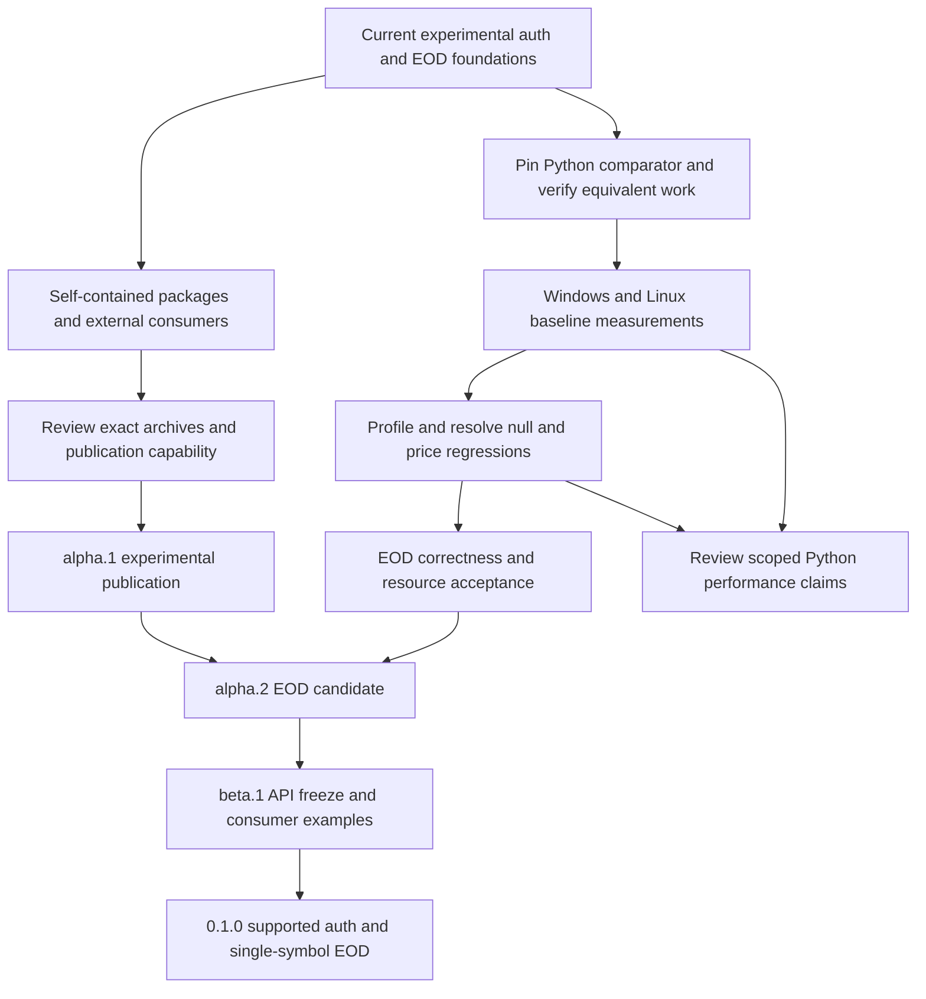

# Release milestones

Status: selected release plan, 2026-10-04. These are ordered, gate-based targets,
not published versions or calendar promises. The current workspace's `0.1.0`
is an unpublished development version. Preserve the independent Python baseline
in the [protocol manifest](../crates/praevis-thetadata-proto/schema/manifest.json).

The first supported release will cover authentication and one stock EOD slice.
Generated bindings for 82 RPCs do not make 82 supported features. Every release
must state its supported surface and distinguish experimental raw bindings.
Maintainers own release decisions; client/core owners own EOD acceptance;
the account holder operates the optional live checks.

## Ordered release train

| Target | Concrete deliverable | Exit gates | Depends on / remaining work |
| --- | --- | --- | --- |
| `0.1.0-alpha.1` | Useful first publication of auth, core, proto, client and CLI; client EOD clearly experimental | Self-contained archives and licenses; dependency versions/order; Windows/Linux external consumer builds; verified registry owner/publish capability; manually recorded PROD auth and small EOD result, or explicit documented service blocker before reconsidering scope; exact archive review and publication approval | [Packaging plan](crates-io-release-plan.md), [manual live verification](live-verification.md). No empty placeholder crates. |
| `0.1.0-alpha.2` | EOD feature-complete candidate: exact numeric delivery and Table adapter, bounded lifecycle and documented real-service behavior | Close every applicable clause in the [EOD matrix](requirements/stock-eod-matrix.md); resolve measured null/price regressions or approve a measured per-workload tradeoff; calibrate resource defaults; compare authorized live captures with all three local interfaces; record unresolved service semantics explicitly | Alpha.1; current performance and resource work; real account/entitlements and captures. |
| `0.1.0-beta.1` | Freeze auth/EOD public API for the first supported release; runnable consumer examples and troubleshooting | Accept or revise the applicable proposed ADRs; requirement-to-test/evidence review; partial-result and cancellation examples; install/build outside workspace; document supported platforms, native-store prerequisites, resource policy and compatibility boundaries | Alpha.2; release review covers API stability, packaging and diagnostics. |
| `0.1.0` | Supported auth + single-symbol stock EOD libraries and auth CLI | No unresolved blocker for the declared surface; green synthetic Windows/Linux checks; maintainer-reviewed manual PROD report on the release candidate; retained benchmark comparison and calibrated acceptance decision; signed-off release checklist below | Beta.1. This is not full Python parity and makes no flat-file/real-time promise. |
| `0.2.0` | Typed stock discovery, snapshots, OHLC/trade/quote history and at-time slices, delivered in small prereleases | Define per-slice ADRs and L1/L2/L3 first; reconcile inventory entries, wire presence, bounded output and account entitlements; synthetic/fault tests, optional manual live evidence and before/after data-path benchmarks for each newly supported slice | Stable first slice; select endpoint order from consumer needs. Raw bindings remain experimental until individually accepted. |
| `0.3.0` | Typed option/index slices, calendars and interest-rate history | Explicit option-contract identity, expiration/strike semantics, precise values and endpoint-specific output/resource requirements; each selected inventory item gains implementation and verification links | Stock patterns established; research unresolved contracts before implementation. Publish the exact supported endpoint list. |
| `0.4.0` | Flat-file downloads as a separately bounded interface | Dedicated ADRs for signed URLs, download lifecycle, retries/resume, integrity, credentials, storage and cancellation; entitlement verification; fault injection and manual service checks | Do not route manifests through the table decoder. Corporate-action support requires separate source/contract evidence before selection. |
| `0.5.0` | Real-time subscription interface, subject to supported vendor contracts | Explicit session/subscription lifecycle, reconnect/gap semantics, ordering, slow-consumer policy and resource budgets; deterministic mocks and limited authorized live checks | No inferred token refresh/revocation; obtain evidence for transport and subscription contracts first. |
| `1.0.0` | Stable declared Rust API and compatibility matrix | Every upstream inventory item has a reviewed supported/excluded/unresolved disposition; all advertised features accepted; migration/versioning policy; repeatable release and performance evidence; resolve any blocker to a full-parity claim before making one | The preceding versions may expose deliberate subsets. A stable API alone does not prove complete Python equivalence. |
| Separate PyO3 `0.1.0` | Python adapters over stabilized Rust interfaces | Binding ADRs/requirements, ownership/async/error/cancellation contracts, packaging/platform tests, copy/allocation and Python-transfer benchmarks | Separate project after Rust interfaces stabilize; keep Python outside core/auth/client dependencies. |

Later version scopes are planning allocations, not approval of undocumented
vendor behavior. Split a milestone into additional prereleases when its evidence
is incomplete; change the plan explicitly rather than silently dropping features.
Initially version the five workspace crates together. A future independent
crate-version policy needs a release decision and dependency compatibility plan.

Optional Terminal track: target a first REST EOD adapter for an operator-started
v3 JAR in the `0.2.0` prereleases, with explicit HTTP/value/resource contracts and
manual per-tier evidence under [ADR-0018](adr/0018-explicit-connection-adapters.md).
Target process supervision only after attached-process behavior is accepted;
keep WebSocket subscription work in the `0.5.0` event milestone. Do not delay or
add Java to direct auth/EOD users. Every release records available and not-run
product/tier/connector cells in the [subscription matrix](subscription-testing.md).

## Immediate execution order

Start with alpha.1 packaging and a reproducible Python comparison baseline.
The sixteen-column synthetic EOD regression corpus and the Praevis ThetaData
naming decision are complete at `1899725`; archive readiness and performance
acceptance are still open. Existing timings compare Rust implementations, not
the vendor Python package. The [Python comparison plan](performance/python-comparison.md)
defines the evidence needed before advertising an advantage over Python.

The Python comparison is a selected demonstration objective. It does not add an
unmeasured universal-speedup condition to alpha.1 or replace the existing EOD
acceptance gates. If a workload shows no advantage, retain that result and
limit the claim. A faster decoder alone does not close a correctness gate.

| Order and owner | Concrete next change | Completion evidence | Milestone |
| --- | --- | --- | --- |
| 1. Release maintainer | Add the four missing library READMEs, archive licenses/NOTICE, registry dependency versions and self-contained client build inputs; decide internal benchmark/manual-runner archive inclusion | Reviewed five-package file lists and extracted archives; no sibling checkout dependencies; candidate hashes | alpha.1 preparation |
| 2. Release maintainer | Rehearse first-wave then dependent packaging in an isolated staging registry; build/install external consumers on Windows and Linux | Archive builds, consumer logs and dependency resolution from outside the workspace; name/owner/token capability checks recorded without secrets | alpha.1 exit |
| 3. Performance maintainer, alongside packaging | Implement the pinned Python comparator and common fixture/output checks described in the comparison plan | Hash-verified artifact and dependency lock, harness provenance, passing semantic checks, repeatable local commands; no performance claim yet | Demonstration baseline |
| 4. Client/core owners | Measure the unchanged Rust candidate against Python and the retained Rust control; profile null/price costs, then change one cause at a time | Repeated Windows/Linux per-workload latency, throughput and process-memory reports; equivalent outputs and all regressions retained | alpha.2 performance evidence |
| 5. Client/core owners | Close remaining EOD matrix clauses and resource calibration | Dependency-log/session/URL sentinels, timeout metadata, controlled-clock interleavings, timestamp boundaries, partial-result example, text/header extremes and supported query-cap range; transport/C allocation measured separately | alpha.2 acceptance |
| 6. Account holder and maintainer | Select bounded additional live EOD date/schema/empty-result cases and available tier checks | Explicit query/credential selection, private capture hashes, raw/numeric/Table replay and reviewed observations; unavailable paid tiers remain not-run | Live evidence for declared scope |
| 7. Maintainers | Review the exact alpha.1 artifacts for publication; later review EOD acceptance and API freeze | Publication approval after archive/consumer checks; alpha.2 evidence decision; beta examples and accepted/revised ADRs; final release checklist | alpha.1, then alpha.2, beta.1 and 0.1.0 |

Rows 1-2 are the first implementation PR; row 3 is an independent benchmark PR.
Run row 4's baseline before optimizing. Complete row 5 against the
[acceptance matrix](requirements/stock-eod-matrix.md), retaining its per-clause
evidence. Select row 6 from the [subscription matrix](subscription-testing.md);
live checks remain manual and outside CI. Alpha.1 can precede rows 4-5, with
experimental scope stated in its release notes. Publish no comparative numbers
until the comparator, outputs and measurement boundaries have been reviewed.

## Checklist for every release candidate

| Evidence | Owner | Required record |
| --- | --- | --- |
| Scope and change control | Maintainers | Version, source commit, advertised APIs, known limitations, upstream version and impact review; upstream/enhancement contracts checked separately |
| Requirements and decisions | Component owners | IDs, accepted ADR decisions, passing evidence and remaining exclusions; no gaps hidden by aggregate inventory counts |
| Correctness | Component owners | Windows/Linux synthetic tests, fault/lifecycle matrix and documentation audits; ordinary CI stays credential-free |
| Performance | Client/core owners | Common-harness before/after samples, host/toolchain/source hashes, per-shape regressions, resource policy and reviewed tolerances; live latency is observational, not a decoder benchmark |
| Live interoperability | Account holder + maintainer | Optional manually invoked PROD run on the candidate, time/environment/query, protocol/build hashes, terminal state and private response hashes, replay/comparison report and reviewed service observations; a service outage is recorded as a blocker, not success |
| Packaging | Release maintainer | Exact package/version list, archive hashes, licenses, self-contained build inputs, registry dependency resolution, external consumers, owner/token checks |
| Publication | Release maintainer | Approval of exact public artifacts; ordered publish, tag/release notes, registry visibility and clean install checks; no automatic first publication |

The live suite is optional to contributors and never a pipeline step. A release
maintainer runs it manually when closing a live-compatibility release gate.
Do not publish raw licensed responses, account identity, session tokens or keys
as CI artifacts or release attachments. A sanitized summary may describe
verified behavior, scope and hashes after review.

Patch releases fix the advertised surface without adding unsupported endpoint
claims. Pre-1.0 breaking API changes require release notes and a deliberate minor
or prerelease change; never silently reinterpret stable requirement IDs.
